# Manual de usuário — GeoRural DataHub

**Equipe Atlaz** · Projeto Fatec para a Visiona — Tecnologia Espacial
São José dos Campos - SP · 2º semestre de 2026

Integrantes: Gabriel Rocha · Leandro Campos · Manuela Brito Migri · Gabriel Valente ·
Gabriel Nunes · Rodolfo Corbalan

## Sumário

1. [Agradecimentos](#agradecimentos)
2. [Apresentação](#apresentação)
3. [Requisitos de sistema](#requisitos-de-sistema)
   - [Funcionais](#funcionais)
   - [Não funcionais](#não-funcionais)
4. [Como instalar e rodar](#como-instalar-e-rodar)
   - [Back-end](#back-end)
   - [Front-end](#front-end)
   - [Primeira carga de dados](#primeira-carga-de-dados)
   - [Usuários de teste](#usuários-de-teste)
5. [Como usar](#como-usar)
   - [Entrar e sair](#entrar-e-sair)
   - [Perfis de acesso](#perfis-de-acesso)
   - [Visão geral da tela](#visão-geral-da-tela)
   - [Dashboard operacional](#dashboard-operacional)
   - [Fontes de dados](#fontes-de-dados)
     - [Cadastrar uma fonte por envio de arquivo (upload)](#cadastrar-uma-fonte-por-envio-de-arquivo-upload)
     - [Cadastrar uma fonte por link (coleta automática)](#cadastrar-uma-fonte-por-link-coleta-automática)
   - [Mapeamento de colunas](#mapeamento-de-colunas)
   - [Quarentena](#quarentena)
   - [Imóveis rurais](#imóveis-rurais)
   - [Indicadores](#indicadores)
   - [Rastreabilidade](#rastreabilidade)
   - [Usuários e perfis](#usuários-e-perfis)
     - [Cadastrar um novo usuário](#cadastrar-um-novo-usuário)
6. [Mensagens comuns e o que fazer](#mensagens-comuns-e-o-que-fazer)
7. [Limitações conhecidas](#limitações-conhecidas)

## Agradecimentos

"Agradecemos à Visiona — Tecnologia Espacial pela oportunidade de desenvolver este sistema web.
Como grupo, nos comprometemos a simplificar o seu dia a dia e otimizar a sua rotina de trabalho."

**Gabriel Rocha** — Agradeço à Visiona pela oportunidade de desenvolver este projeto e,
principalmente, à minha equipe pela parceria e pelo trabalho conjunto durante todo o processo.

**Leandro Campos** — _a escrever_

**Manuela Brito Migri** — Agradeço aos meus colegas de API pelo apoio e companheirismo ao longo
deste trabalho. Grandes conquistas não são feitas por mentes isoladas, mas por equipes que
compartilham a mesma visão com respeito e cumplicidade.

**Gabriel Valente** — _a escrever_

**Gabriel Nunes** — Grato aos companheiros da Visiona por colaborarem com o progresso dos nossos
estudos, e aos meus colegas de equipe por somarem na produtividade e atenderem ao problema da nossa
empresa parceira.

**Rodolfo Corbalan** — _a escrever_

## Apresentação

A Visiona atua em projetos que usam informações territoriais, ambientais e geoespaciais para apoiar
análise, planejamento e tomada de decisão. Nesses projetos, os dados sobre imóveis rurais vêm de
várias fontes, públicas e privadas, e incluem registros cadastrais e informações geográficas
produzidas ao longo do tempo. Como essas fontes têm formatos variados, níveis de qualidade
diferentes e são atualizadas com frequência, fica difícil rastrear e auditar os dados. Muitas vezes
não se consegue saber de qual fonte, versão e processamento veio uma informação exibida, e isso
prejudica a transparência e a confiabilidade.

Para resolver esse problema, o projeto propõe o **GeoRural DataHub**, uma plataforma web com
back-end em **Spring Boot (Java)** e front-end em **Vue.js**, sobre um banco **Oracle** com dados
espaciais. A plataforma:

- cataloga as **fontes de dados** e guarda cada arquivo recebido sem alterações, com prova de
  integridade (hash SHA-256); as fontes chegam por **envio de arquivo** ou por **coleta automática**
  no link do órgão, que se repete sozinha conforme a periodicidade de cada fonte;
- **processa e valida** os dados do Cadastro Ambiental Rural (CAR), da Reserva Legal do CAR e dos
  focos de calor do INPE antes de disponibilizá-los;
- retém numa **quarentena** os registros que não passam nas regras, para que sejam corrigidos,
  revalidados ou descartados com justificativa;
- permite definir, por fonte, **para onde vai cada coluna** e quais regras de qualidade valem para
  ela;
- exibe os **imóveis rurais do Paraná** em mapa e tabela, com os **indicadores** de Reserva Legal
  (IRL) e de focos de calor (IFC) de cada imóvel e os **indicadores cadastrados pela própria
  equipe** (desmatamento, áreas protegidas, embargos, vegetação nativa…);
- resume a operação num **dashboard** (fontes ativas, falhas, quarentena, coletas e execuções);
- mostra a **rastreabilidade** de cada indicador: de qual arquivo, versão e regra veio o número;
- controla o **acesso por perfil** (Operador de dados, Analista, Auditor e Gestor), com login pelo
  Keycloak; o próprio Gestor cadastra as pessoas, define os perfis, libera as cidades de cada
  Analista e redefine senhas, numa tela do sistema.

## Requisitos de sistema

### Funcionais

#### RF01 — Cadastro de fontes e importação de arquivos

> Como Operador de Dados, quero cadastrar fontes de dados e importar seus arquivos para que os
> dados recebidos sejam armazenados de forma íntegra e possam ser usados pela aplicação.

- O sistema permite cadastrar uma fonte informando nome, sigla (até 12 caracteres, gravada em
  maiúsculas), órgão responsável, formato (CSV, GeoJSON ou SHP) e periodicidade de atualização
  (diária, semanal, mensal, anual ou eventual).
- O sistema impede duas fontes com a mesma sigla, sem diferenciar maiúsculas de minúsculas.
- O sistema lista as fontes cadastradas, com o status de cada uma (**Ativa**, **Sem arquivo** ou
  **Inativa**) e o último arquivo recebido, e permite filtrá-las e juntá-las em **grupos** (que só
  organizam a tela).
- O sistema permite **desativar** e **reativar** uma fonte. Desativada, ela não recebe arquivos nem
  coletas; os dados que já gravou continuam valendo.
- O sistema permite importar um arquivo para uma fonte nos formatos `.csv`, `.zip`, `.geojson`,
  `.json`, `.shp`, `.xlsx` ou `.txt`, com até 500 MB.
- O arquivo original é guardado sem alterações na **zona bruta** do Object Storage, com o hash
  SHA-256 e a data/hora do recebimento. Essa cópia nunca é sobrescrita.
- O sistema informa o status de cada arquivo: **Recebido**, **Processando**, **Processado**,
  **Rejeitado** ou **Aguardando mapeamento**.
- O sistema permite excluir um arquivo **Rejeitado** que nunca gerou versão de dados. Arquivos
  processados não podem ser excluídos, para preservar o histórico.
- O sistema permite cadastrar uma fonte que é coletada por **link** (serviço WFS/GeoServer, ArcGIS
  ou arquivo para download), informando o método (GET ou POST), cabeçalhos opcionais e, no POST, o
  corpo da requisição; testar a conexão com o link antes de salvar; e coletá-la sob demanda pelo
  botão **Executar**. O arquivo coletado é guardado na zona bruta como um envio comum. Se o
  conteúdo baixado for idêntico ao da última coleta, nada é gravado. Por segurança, links que
  apontam para endereços internos da rede são recusados.
- **Coleta automática:** depois da primeira coleta manual, o sistema coleta de novo cada fonte por
  link quando vence a periodicidade (ou o `cron` da fonte, em horário de Brasília, se houver). A
  conferência é feita de hora em hora pelo back-end; o Airflow só é chamado para a fonte que
  venceu. Fontes eventuais ou desativadas ficam de fora, e uma coleta que falhou só é tentada de
  novo no período seguinte.

#### RF02 — Processamento e validação dos dados

> Como Operador de Dados, quero que os arquivos sejam processados e validados antes de ficarem
> disponíveis, para que só dados confiáveis cheguem à consulta.

- O sistema processa arquivos de qualquer fonte, guiado pelo mapeamento de colunas: `.zip` com
  shapefile (`.shp`, `.shx`, `.dbf`, `.prj`) ou com as páginas GeoJSON da coleta por link,
  `.geojson`/`.json` e `.csv` (geometria em WKT ou em colunas de latitude e longitude).
- O processamento começa sozinho (pelo Airflow) assim que o arquivo chega, sem outra ação do
  Operador.
- Cada registro é validado. No CAR, por exemplo: código vazio ou repetido, geometria ausente, que
  não seja polígono, inválida ou totalmente fora do Paraná. Os reprovados vão para a
  **quarentena**, com o tipo de erro e o motivo; os demais são gravados.
- Os focos de calor de outros estados são apenas contados e ignorados; não vão para a quarentena.
- O sistema ajusta o sentido do contorno dos polígonos para o padrão exigido pelo banco.
- Reprocessar um arquivo não duplica dados: imóveis são atualizados pelo código do CAR, e focos já
  existentes não são inseridos de novo.
- Ao final, o arquivo fica **Processado** (com o total de registros lidos, válidos e inválidos) ou
  **Rejeitado** (com a mensagem de erro). Se ocorrer erro, nada daquele arquivo é gravado.
- O sistema permite processar de novo um arquivo **Recebido**, **Rejeitado** ou **Aguardando
  mapeamento**, **reprocessar** o arquivo processado mais recente depois de mudar o mapeamento e
  **interromper** um processamento em andamento. O andamento aparece numa barra de progresso.
- Cada imóvel gravado mantém o vínculo com a versão do conjunto de dados e com a execução que o
  produziu.

#### RF03 — Mapeamento de colunas e regras de qualidade

> Como Operador de Dados, quero definir para onde vai cada coluna de uma fonte e quais regras
> valem para ela, para que a validação siga as regras do negócio.

- O sistema mostra as colunas detectadas nos arquivos da fonte, marcadas como **Mapeada**,
  **Nova** (chegou e ainda não tem destino) ou **Ausente** (não veio no último arquivo).
- A fonte avisa na lista quando tem colunas novas sem mapeamento.
- Para cada coluna, o Operador define a tabela e o campo de destino, o tipo de dado (texto,
  inteiro, decimal, data, booleano ou geometria) e as regras: obrigatório, chave do registro,
  bloqueio de regressão, domínio de valores, referência cruzada (município ou imóvel), validação de
  CPF/CNPJ, formato de data e, para geometria, a política para geometria inválida (quarentena ou
  correção automática) e a conferência de que está no Paraná.
- O sistema permite remover um mapeamento.

#### RF04 — Quarentena

> Como Operador de Dados, quero analisar e tratar os registros reprovados, para corrigir o que
> for possível sem alterar o dado original.

- O sistema lista os registros retidos, com filtros por texto, tipo de erro, fonte e status, e
  mostra métricas por status (pendentes, em análise, corrigidos, revalidados, descartados).
- O registro passa pelos status **Pendente → Em análise → Corrigido → Revalidado**, ou termina como
  **Descartado** (com justificativa obrigatória) ou **Substituído** (quando uma carga mais nova
  trouxe o mesmo registro).
- O dado original nunca é alterado: a correção é guardada à parte.
- O Operador pode corrigir os campos do registro e, quando o problema é a geometria, editar os
  vértices no mapa, desenhar uma geometria nova ou pedir uma correção automática, que é mostrada
  como prévia antes de ser salva.
- Ao **revalidar**, o registro passa de novo por todas as regras. Se aprovado, é gravado na zona
  tratada; se reprovado, o sistema lista os erros que continuam.
- Registros revalidados, descartados ou substituídos ficam encerrados, com o histórico guardado
  para auditoria.

#### RF05 — Consulta de imóveis rurais via API

> Como Analista, quero consultar os imóveis rurais por meio de uma API para que suas informações
> territoriais possam ser consumidas pela aplicação.

- O sistema disponibiliza uma API que lista os imóveis de forma paginada (até 500 por página),
  sem a geometria, com código, município, área (ha) e situação no CAR (Ativo, Pendente, Cancelado
  ou Suspenso).
- O sistema permite filtrar por município (nome), situação no CAR e parte do código do imóvel.
- O sistema permite consultar um imóvel pelo código do CAR, com a geometria em GeoJSON.
- O sistema devolve os imóveis de uma área do mapa em GeoJSON, com geometria simplificada e um
  limite de quantidade.

#### RF06 — Visualização em mapa e tabela

> Como Analista, quero visualizar os imóveis rurais e as divisões territoriais em um mapa para
> localizar e analisar espacialmente os imóveis do Paraná.

- O sistema exibe os imóveis do Paraná em um mapa interativo, sincronizado com uma tabela.
- Abaixo de um nível de zoom, o mapa não carrega imóveis e pede ao usuário que aproxime.
- O mapa fica restrito ao Paraná e desenha o contorno do município escolhido no filtro.
- O mapa exibe os focos de calor do INPE considerados pelo indicador IFC.
- Ao selecionar um imóvel no mapa ou na tabela, a seleção é sincronizada e o sistema mostra
  código, município, área e situação.
- Sob demanda, a tabela mostra o pior status dos indicadores cadastrados de cada imóvel da página,
  o mapa pinta os imóveis com a cor desse status e um gráfico mostra a distribuição por status.
- O Analista vê só os imóveis das cidades liberadas para ele pelo Gestor.

#### RF07 — Indicadores e rastreabilidade

> Como Analista, quero ver os indicadores ambientais de cada imóvel e saber de onde veio cada
> número, para confiar no resultado e poder auditá-lo.

- O sistema calcula, para cada imóvel:
  - **IRL — Índice de Reserva Legal:** área de Reserva Legal ÷ área do imóvel. O mínimo é 20%
    (Mata Atlântica e Cerrado): a partir dele o imóvel fica **Conforme**; abaixo, **Crítico**. O
    sistema mostra quantos hectares faltam ou sobram.
  - **IFC — Índice de Focos de Calor:** focos dentro do imóvel a cada 1.000 ha, nos últimos 12
    meses, do satélite de referência (AQUA_M-T). Sem focos: **Sem focos**; abaixo de 20:
    **Alerta**; 20 ou mais: **Crítico**.
- Além do IRL e do IFC, a equipe pode **cadastrar indicadores** pela tela, escolhendo a fonte, um
  modelo de cálculo pronto (densidade de pontos, cobertura de área ou cobertura dentro de uma
  camada), filtros opcionais (categoria, data, mínimo exigido) e faixas de status. Um indicador pode
  ser desativado e reativado, e o resultado pode ser visto agrupado por município.
- O cálculo é disparado sob demanda e vale para todos os imóveis de uma vez.
- As regras de cálculo são versionadas; recalcular não duplica resultados.
- Para cada indicador, o sistema mostra o caminho até a origem: fonte, arquivo, hash e versão dos
  dados de entrada; a regra e a fórmula aplicadas; e a conta do resultado.
- O sistema mostra o histórico de cálculos de um indicador e o que mudou em relação ao cálculo
  anterior (o dado, a regra ou os dois).

#### RF08 — Login e controle de acesso por perfil

> Como pessoa usuária do sistema, quero entrar com meu usuário e senha e ver apenas o que o meu
> perfil permite, para que os dados e as operações fiquem protegidos.

- O sistema exige login para usar qualquer tela e qualquer rota da API. Sem um login válido, a API
  responde com erro 401 ("Autenticação necessária: envie um token válido.").
- O login é feito numa tela do **Keycloak**, com a identidade visual do GeoRural e em português. A
  senha não passa pelo front-end do sistema.
- Cada pessoa tem um ou mais **perfis**: Operador de dados, Analista, Auditor e Gestor.
- O menu mostra só as telas liberadas ao perfil. Quem digita o endereço de uma tela que o seu perfil
  não vê é levado a uma tela permitida. Quem não tem nenhum perfil vê "Sem acesso a nenhuma área".
- Os botões que alteram dados (cadastrar, importar, mapear, processar, corrigir, descartar,
  calcular) só aparecem para Operador de dados e Gestor.
- A API também barra no servidor: um perfil sem permissão recebe erro 403 ("Você não tem permissão
  para acessar este recurso."), mesmo que a chamada seja feita fora da tela.
- A sessão é renovada automaticamente enquanto a pessoa usa o sistema (cada acesso vale 15
  minutos). Quando a sessão termina, o sistema volta ao login.
- O topo da tela mostra o nome e o perfil de quem está conectado e o botão **Sair**.

#### RF09 — Gestão de usuários e perfis

> Como Gestor, quero cadastrar os usuários do sistema e definir o que cada um pode usar, para
> controlar quem acessa cada área sem depender da equipe técnica.

- O sistema lista os usuários, com nome, usuário, e-mail, perfis, situação (ativo ou inativo) e, no
  Analista, a região liberada, e permite buscar por nome, usuário ou e-mail. A lista é paginada (20
  por página).
- O Gestor **cadastra** um usuário com nome, sobrenome, login, e-mail, senha provisória (que a
  pessoa troca no primeiro login) e perfis.
- O Gestor define as **cidades que cada Analista pode consultar** (todas ou uma lista de
  municípios do Paraná); a consulta de imóveis respeita essa restrição.
- O Gestor **ativa e desativa** usuários (o usuário desativado não entra, mas os perfis ficam
  guardados) e **redefine a senha** de quem esqueceu, com uma nova senha provisória.
- O Gestor define os perfis de um usuário marcando ou desmarcando os quatro perfis do GeoRural e os
  **perfis combinados**, que ele mesmo cria juntando perfis existentes (ex.: Analista + Auditor).
- O Gestor não pode remover o próprio perfil de Gestor nem desativar o próprio usuário, para não
  perder o acesso ao sistema.
- Um usuário sem nenhum perfil consegue entrar, mas não acessa nenhuma tela.
- A mudança de perfil vale no próximo login da pessoa (ou em até 15 minutos, se ela estiver
  conectada).
- Só o Gestor acessa esta tela e esta parte da API; os demais perfis recebem erro 403.
- Se o servidor de login (Keycloak) estiver fora do ar, a tela avisa que o serviço de autenticação
  está indisponível.

### Não funcionais

**Tecnologia e arquitetura**
- Back-end em Java 17 com Spring Boot; front-end em Vue 3 com Vite, Leaflet e Tailwind.
- Banco de dados Oracle; dados geoespaciais em colunas `SDO_GEOMETRY`, acessadas via Hibernate
  Spatial e JTS. As regras de qualidade, a gravação na zona tratada e o cálculo dos indicadores
  rodam em pacotes PL/SQL no próprio banco.
- Estrutura do banco versionada com Flyway (criada automaticamente na primeira subida).
- API REST em JSON; geometrias em GeoJSON.
- Autenticação e autorização com **Keycloak 26** (OpenID Connect), em Docker. O realm `georural`
  (perfis, usuários de teste, clients e tela de login) é importado do arquivo
  `keycloak/georural-realm.json`, no repositório do back-end.
- Arquivos originais guardados na zona bruta do Object Storage da Oracle Cloud (OCI).
- O processamento e a coleta são feitos pelo orquestrador **Apache Airflow** (configurado em
  `infra/airflow` neste repositório). O back-end só registra os pedidos e o Airflow faz o trabalho:
  processa qualquer fonte pelo mapeamento de colunas, coleta os links em páginas e recalcula os
  indicadores ao final.

**Integridade e rastreabilidade dos dados**
- O processamento de um arquivo é transacional: se ocorrer erro, nenhum dado parcial é gravado.
- O arquivo original e o registro original na quarentena nunca são alterados.
- Cada imóvel e cada indicador mantêm o vínculo com a versão dos dados e a execução que os
  produziram.
- O histórico de arquivos processados, execuções, quarentena e cálculos não é apagado.
- As geometrias são armazenadas em **EPSG:4326 (WGS84)**. As fontes originais (CAR, IBGE) usam
  SIRGAS 2000; a diferença entre os dois é menor que 1 metro, abaixo da precisão do próprio CAR, e
  por isso é ignorada de propósito — decisão registrada na documentação técnica.

**Desempenho**
- As listagens são sempre paginadas e não trazem geometria.
- O mapa carrega só a área visível, a partir de um nível de zoom, com no máximo 1.000 imóveis por
  vez (a API aceita até 3.000) e avisa quando há mais imóveis do que o exibido. As geometrias são
  simplificadas conforme o zoom.
- O limite de tamanho de arquivo para importação é de 500 MB.

**Segurança**
- A coleta por link só aceita `http`/`https`, recusa endereços internos da rede, limita
  redirecionamentos, tempo de resposta e tamanho do download.
- Cabeçalhos de requisição das fontes por link não são devolvidos pela API.
- Toda rota da API exige um token válido do Keycloak. O back-end valida o token (Spring Security
  como *resource server*) e libera cada rota só para os perfis da matriz de permissões.
- O login do front-end usa *Authorization Code com PKCE* (keycloak-js); o token fica só em memória
  e a senha nunca passa pelo sistema.
- Os perfis são *realm roles* do Keycloak (`OPERADOR_DADOS`, `ANALISTA`, `AUDITOR`, `GESTOR`) e
  vão dentro do token. O que o front-end esconde (menu, telas e botões) é só conforto: quem barra
  de verdade é o back-end.
- Para gerenciar usuários, o back-end usa uma conta técnica (`georural-backend`) com as permissões
  mínimas do Keycloak para consultar, criar e alterar usuários. A gestão só aceita os perfis do
  GeoRural (os quatro do sistema e os combinados, que viram *composite roles* no Keycloak) e é
  restrita ao Gestor.
- A coleta automática fica desligada por padrão no back-end (`COLETA_AUTOMATICA_HABILITADA`), para
  não coletar dos serviços públicos a partir do computador de quem desenvolve; em produção
  ela vem ligada.

**Usabilidade e confiabilidade**
- As mensagens de erro da API vêm em português, com o código HTTP apropriado.
- O andamento do processamento é atualizado automaticamente na tela, sem recarregar a página.
- A interface tem modo claro e modo escuro.
- A tela de login tem a identidade visual do GeoRural e está em português do Brasil.

**Manutenibilidade**
- Código versionado no GitHub, com o fluxo de branches `feature → dev → main` e revisão por Pull
  Request.
- O back-end segue arquitetura em camadas (`controller` → `service` → `repository`).
- A matriz de permissões por perfil vive em dois lugares que precisam andar juntos: `SecurityConfig`
  (back-end) e `router/index.js` com `usePermissoes.js` (front-end).
- A memória de cálculo dos indicadores, com exemplos reais e o passo a passo de conferência no
  QGIS, está em `docs/memoria-de-calculo/` no repositório do back-end.

## Como instalar e rodar

O GeoRural é formado por dois projetos: o **back-end** (a API) e o **front-end** (a tela). Os dois
precisam estar rodando para usar a aplicação por completo.

### Back-end

**Pré-requisitos:** JDK 17, Docker Desktop, Git e uma credencial válida da Oracle Cloud (OCI) para
o Object Storage.

1. Clone o repositório `Atlaz4-BackEnd` (ou rode `git submodule update --init` neste repositório:
   ele traz o back-end na pasta `backend` e o front-end na pasta `frontend`).
2. Copie o `.env.example` para `.env`, na raiz do projeto, e preencha `OCI_NAMESPACE`,
   `OCI_BUCKET`, `DB_USERNAME` e `DB_PASSWORD`. Para processar e coletar, suba também o Airflow
   (`infra/airflow/README.md` deste repositório). O login usa valores padrão de desenvolvimento;
   para trocá-los, veja a observação depois do passo 6.
3. Configure a credencial da OCI em `~/.oci/config`, no perfil `DEFAULT`. **Sem esse arquivo a
   aplicação não inicia**, mesmo que você não vá enviar arquivos.
4. Suba o banco e o servidor de login (Keycloak): `docker compose up -d`. A primeira subida demora
   alguns minutos; o banco está pronto quando `docker logs oracle` mostrar
   `DATABASE IS READY TO USE!`. O Keycloak fica em `http://localhost:8081` e importa sozinho o
   realm `georural` (perfis, usuários de teste e tela de login) quando o container é criado. O
   painel de administração dele é `http://localhost:8081/admin/master/console/`, com usuário e
   senha padrão de desenvolvimento `admin` / `admin`.
5. Rode a aplicação: `mvnw.cmd spring-boot:run` (Windows) ou `./mvnw spring-boot:run`. As tabelas
   são criadas automaticamente na primeira subida.
6. A API fica disponível em `http://localhost:8080/api/v1`.

> **Login (Keycloak).** Valores que podem ser definidos no `.env`: `KEYCLOAK_URL` (padrão
> `http://localhost:8081`), `KEYCLOAK_BACKEND_SECRET` (segredo da conta técnica do back-end),
> `KEYCLOAK_ADMIN` e `KEYCLOAK_ADMIN_PASSWORD` (administrador do painel). Os padrões servem só para
> desenvolvimento.
>
> **Recriar o Keycloak** (para aplicar uma mudança em `keycloak/georural-realm.json` ou no tema de
> login): `docker rm -f keycloak` e depois `docker compose up -d --no-deps keycloak`. O realm só é
> importado quando o container é criado. **Nunca use `docker compose down -v`**: ele apaga também o
> volume do banco Oracle.

### Front-end

**Pré-requisitos:** Node.js 18 ou mais recente e npm 9 ou mais recente.

1. Clone o repositório `Atlaz4-FrontEnd` (ou use a pasta `frontend` deste repositório).
2. Instale as dependências: `npm install`.
3. Copie o `.env.example` para `.env.development`.
4. Edite o `.env.development` e defina, com o back-end e o Keycloak já rodando:
   - `VITE_API_URL=http://localhost:8080/api/v1`
   - `VITE_KEYCLOAK_URL=http://localhost:8081`
   - `VITE_KEYCLOAK_REALM=georural`
   - `VITE_KEYCLOAK_CLIENT_ID=georural-frontend`
5. Rode `npm run dev`. O navegador abre sozinho em `http://localhost:5173` e vai para a tela de
   login (veja [Entrar e sair](#entrar-e-sair)).

> **Só para testar o envio de arquivos, sem o back-end:** mantenha o `VITE_API_URL` do
> `.env.example` e rode `npm run start`, que sobe um servidor de exemplo junto com a tela. Esse
> servidor só atende a lista de fontes e o envio de arquivos; Quarentena, Imóveis rurais,
> Rastreabilidade, processamento e mapeamento só funcionam com o back-end real. Como esse servidor não valida o login, defina também
> `VITE_AUTH_HABILITADO=false` no `.env.development`.

### Primeira carga de dados

Com o banco vazio e o Airflow ligado, carregue os dados nesta ordem — cada etapa depende da anterior:

1. **Cadastre as fontes por link:** rode uma vez o `db/seed-demo/fontes.sql` do back-end. Ele
   cadastra as fontes `MUN-IAT`, `CAR-WFS`, `RL-IAT`, `FOCOS-IAT` e `FOCOS-INPE` (focos de calor do
   Paraná direto do BDQueimadas do INPE, coleta diária) já com o mapeamento de colunas.
2. **Malha municipal do Paraná:** clique em **Executar** na fonte `MUN-IAT` e espere o arquivo
   ficar `PROCESSADO`. Sem ela, a lista de municípios fica vazia e a conferência "está no Paraná"
   não funciona.
3. **Imóveis do CAR:** **Executar** na fonte `CAR-WFS` (a coleta do Paraná inteiro demora).
4. **Reserva Legal e focos de calor:** **Executar** nas fontes `RL-IAT` e `FOCOS-IAT` (ou
   `FOCOS-INPE`). Os indicadores IRL e IFC são recalculados ao final de cada carga. Com a coleta
   automática ligada, essas fontes passam a se atualizar sozinhas depois dessa primeira coleta.
5. **Indicadores (opcional):** para recalcular na hora, na tela Imóveis rurais, selecione um
   imóvel e clique em **Calcular indicadores** (ou **Recalcular**). O cálculo é feito para todos os
   imóveis de uma vez.

### Usuários de teste

O realm importado traz quatro usuários para o ambiente de desenvolvimento, todos com a senha
`georural123`:

| Usuário | Perfil |
|---|---|
| `operador` | Operador de dados |
| `analista` | Analista |
| `auditor` | Auditor |
| `gestor` | Gestor |

> **Só para desenvolvimento.** Em um ambiente real, troque ou remova esses usuários e defina uma
> senha própria para o administrador do Keycloak.

## Como usar

### Entrar e sair

Ao abrir o sistema (`http://localhost:5173`), se você ainda não estiver conectado, o navegador vai
para a tela **Entrar na sua conta** do GeoRural DataHub. Ela é do Keycloak, o servidor de identidade do
sistema: a sua senha não passa pelo GeoRural.

1. Digite o **Nome de usuário ou e-mail** e a **Senha**. O ícone de olho mostra a senha digitada.
2. Clique em **Entrar**. Com os dados corretos, o sistema abre na primeira tela liberada ao seu
   perfil.
3. Se os dados estiverem errados, a tela avisa e pede de novo. A recuperação de senha por e-mail não
   está ativada: se esqueceu a senha, peça a um Gestor para redefini-la (veja
   [Redefinir a senha](#redefinir-a-senha-de-alguém)).
4. **Primeiro acesso:** quem recebeu uma senha provisória do Gestor entra com ela e o Keycloak pede
   uma senha nova antes de abrir o sistema.
5. No topo da tela ficam o seu nome e o seu perfil (por exemplo, "Gestor"). Clique em **Sair** para
   encerrar a sessão; o sistema volta ao login.
6. Enquanto você usa o sistema, a sessão é renovada sozinha. Se ela terminar, o sistema volta ao
   login e basta entrar de novo.

### Perfis de acesso

Cada pessoa tem um ou mais perfis, que definem o que ela vê e o que pode fazer:

| Perfil | Em resumo |
|---|---|
| **Operador de dados** | Importa e processa dados: fontes, arquivos, mapeamentos, quarentena e cálculo de indicadores |
| **Analista** | Consulta o mapa, os imóveis, os indicadores e a rastreabilidade das **cidades liberadas** para ele, sem alterar dados |
| **Auditor** | Acompanha fontes, quarentena, indicadores e rastreabilidade, sem alterar dados |
| **Gestor** | Acesso total, inclusive o dashboard e a gestão de usuários e perfis |

Além desses quatro, o Gestor pode criar **perfis combinados**, que juntam dois ou mais deles (por
exemplo, "Coordenador" = Analista + Auditor). Quem recebe um perfil combinado pode tudo o que os
perfis dentro dele podem (veja [Criar um perfil combinado](#criar-um-perfil-combinado)).

O que cada perfil acessa (✔ = pode, — = não aparece):

| Área | Operador de dados | Analista | Auditor | Gestor |
|---|:---:|:---:|:---:|:---:|
| Dashboard operacional | — | — | — | ✔ |
| Fontes de dados: consultar | ✔ | — | ✔ | ✔ |
| Fontes de dados: cadastrar, importar, coletar, processar, mapear colunas, ativar/desativar, excluir | ✔ | — | — | ✔ |
| Quarentena: consultar | ✔ | — | ✔ | ✔ |
| Quarentena: analisar, corrigir, revalidar, descartar | ✔ | — | — | ✔ |
| Imóveis rurais: mapa, tabela e indicadores | ✔ | ✔ (só as cidades liberadas) | ✔ | ✔ |
| Indicadores: consultar e ver por município | ✔ | ✔ | ✔ | ✔ |
| Indicadores: cadastrar, calcular, ativar/desativar | ✔ | — | — | ✔ |
| Rastreabilidade | ✔ | ✔ | ✔ | ✔ |
| Usuários e perfis | — | — | — | ✔ |

- O **menu** mostra só as telas do seu perfil. Os botões que alteram dados (por exemplo **Processar**,
  **Excluir**, **Salvar mapeamento**) só aparecem para Operador de dados e Gestor.
- Se você digitar o endereço de uma tela que o seu perfil não vê, o sistema leva você a uma tela
  permitida.
- Se aparecer **"Sem acesso a nenhuma área"**, a sua conta entrou, mas ainda não tem nenhum perfil.
  Peça a um Gestor para atribuir um (veja [Usuários e perfis](#usuários-e-perfis)) e entre de novo.

### Visão geral da tela

A navegação fica no **menu lateral**, dividido em grupos. Você vê só as telas liberadas ao seu
perfil (veja [Perfis de acesso](#perfis-de-acesso)):

| Grupo | Tela | Para quê |
|---|---|---|
| Visão geral | **Dashboard** | Resumo do dia: fontes ativas, falhas, quarentena, coletas automáticas e últimas execuções |
| Dados | **Fontes de dados** | Ver as fontes, cadastrar, importar arquivos, acompanhar o processamento e mapear colunas |
| Dados | **Quarentena** | Analisar e tratar os registros reprovados |
| Consulta | **Imóveis rurais** | Consultar os imóveis no mapa e na tabela, com os indicadores |
| Governança | **Indicadores** | Cadastrar, calcular, ligar/desligar indicadores e ver o resultado por município |
| Governança | **Rastreabilidade** | Ver de onde veio o número de um indicador |
| Administração | **Usuários e perfis** | Cadastrar pessoas e definir o que cada uma pode usar (somente Gestor) |

No topo ficam o nome da tela, o seu nome e perfil, o botão **Modo claro / Modo escuro** (a escolha
fica salva no navegador) e o botão **Sair**. Em telas estreitas, o menu mostra só os ícones.

### Dashboard operacional

Tela em **Visão geral > Dashboard**, usada pelo Gestor para acompanhar a operação num lugar só.

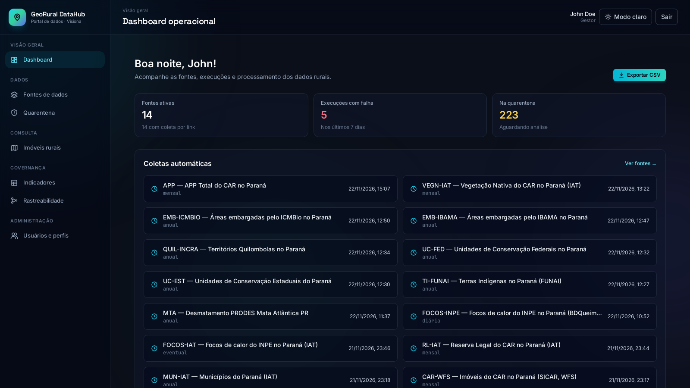

- A saudação ("Boa noite, John!") usa o seu nome e a hora do dia.
- **Cartões de resumo:**
  - **Fontes ativas** — quantas fontes estão ligadas e quantas delas coletam por link;
  - **Execuções com falha** — coletas e processamentos que falharam **nos últimos 7 dias**;
  - **Na quarentena** — registros **aguardando análise** (pendentes).
- **Coletas automáticas:** cada fonte ativa que coleta por link, com a periodicidade (diária,
  mensal, anual…) e a data da última coleta. **Ver fontes →** abre a tela de fontes. Entenda como a
  coleta automática funciona em [Cadastrar uma fonte por link](#cadastrar-uma-fonte-por-link-coleta-automática).
- **Execuções recentes:** as últimas execuções, com a fonte (sigla e nome), a origem (**Coleta por
  link** ou **Upload**), o início, quantos registros e o status (**Concluída**, **Falhou**…).

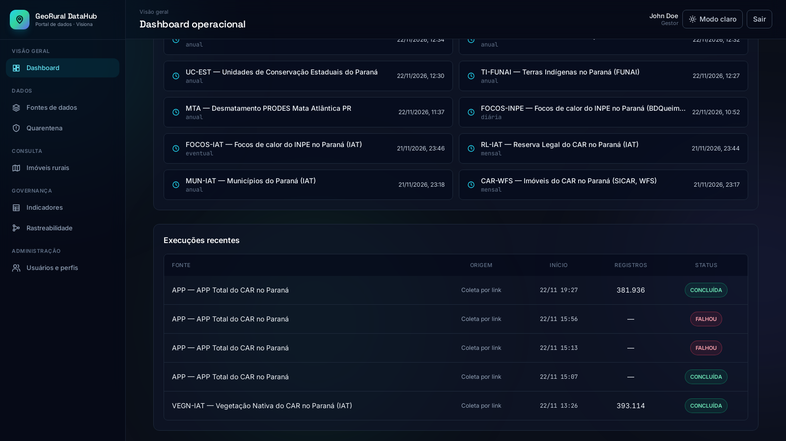

**Exportar CSV** baixa um arquivo com os três números do resumo e as execuções recentes (fonte,
tipo, status, registros lidos, válidos e inválidos e data), para abrir no Excel ou anexar num
relatório.

### Fontes de dados

Tela usada pelo Operador de Dados. Cada fonte é um órgão que entrega dados ao sistema, de um destes
dois jeitos:

- **Upload** (envio de arquivo): alguém da equipe baixa o arquivo e sobe pela tela;
- **Coleta automática** (link): o sistema busca os dados sozinho no endereço do órgão.

A tela mostra as fontes em cards; clicar num card abre a página da fonte, com as abas
**Recebimento**, **Arquivos recebidos**, **Mapeamento** e **Versões**.

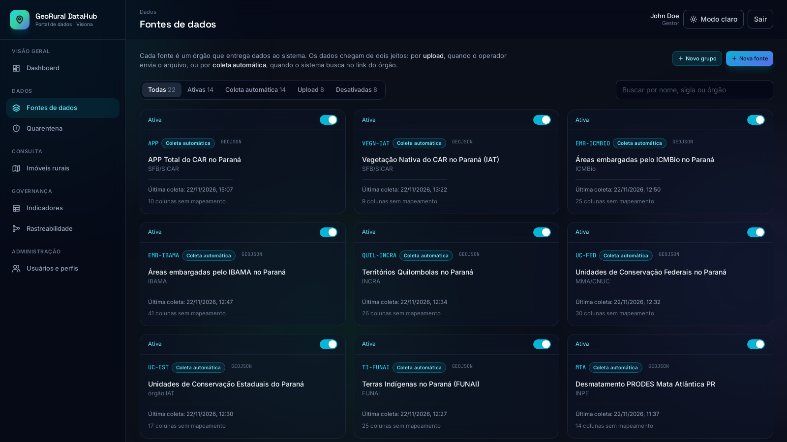

**A lista de fontes:**

- **Filtros no topo:** Todas, Ativas, Coleta automática, Upload e Desativadas, com a quantidade de
  cada uma, e a busca por nome, sigla ou órgão.
- **Cada card** mostra a sigla, a etiqueta **Coleta automática** ou **Upload**, o formato, o nome,
  o órgão, a data da última coleta ou envio e quantas colunas estão **sem mapeamento** (ou o aviso
  "Arquivo aguardando o mapeamento das colunas").
- **A chave no canto do card** ativa ou desativa a fonte. Uma fonte **desativada** ("Desativada ·
  não recebe dados") não recebe arquivos nem coletas, nem automáticas, até ser religada; os dados que
  ela já gravou **continuam valendo** (não são apagados). Na página de uma fonte desativada, o botão
  **Ativar fonte** também religa.
- **Grupos de fontes:** juntam cards numa "pasta" (ex.: uma camada que veio em vários pedaços,
  cada um numa fonte). O grupo **só organiza a tela**: não muda o processamento nem os indicadores.

**Criar um grupo de fontes:**

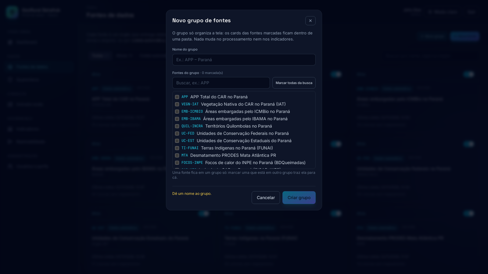

1. Clique em **Novo grupo**.
2. Dê um **Nome do grupo** e marque as fontes que vão ficar dentro dele (**Marcar todas da busca**
   marca de uma vez o que a busca encontrou).
3. Clique em **Criar grupo**. Uma fonte fica em um grupo só: marcar uma que já está em outro grupo
   traz ela para este.

#### Campos do cadastro de fonte

As fontes da demonstração (`MUN-IAT`, `CAR-WFS`, `RL-IAT`, `FOCOS-IAT` e `FOCOS-INPE`) são
cadastradas pelo seed (veja [Primeira carga de dados](#primeira-carga-de-dados)). Para cadastrar
outra, clique em **Nova fonte**. Abre a gaveta **Nova fonte de dados**, com estes campos:

| Campo | Como preencher |
|---|---|
| **Nome da fonte** | Nome por extenso, como aparece nos cards e nos indicadores. Ex.: "Terras Indígenas no Paraná (FUNAI)". |
| **Sigla** | Curta, em maiúsculas, sem repetir outra fonte (ex.: `TI-FUNAI`). **Não muda depois**: é o nome da pasta dos arquivos da fonte na zona bruta. |
| **Formato** | O que o arquivo ou o link **devolve**: **CSV**, **GeoJSON** ou **SHP**. Um serviço ArcGIS ou WFS com `f=geojson` ou `outputFormat=application/json` é **GeoJSON**, mesmo sendo um link. Formato errado faz a carga ler o conteúdo errado. |
| **Órgão responsável** | Quem publica o dado. Quando ele vem por outro órgão, diga os dois: "FUNAI (via IAT/PR)". |
| **Periodicidade** | De quanto em quanto tempo o dado muda na origem: **diária**, **semanal**, **mensal**, **anual** ou **eventual**. Na fonte por **link**, é ela que define a **coleta automática** (veja abaixo). Na fonte por envio de arquivo, é só informativa. |
| **Como os dados chegam** | **Envio de arquivo**: alguém sobe o arquivo pela tela. **Link (coleta)**: o sistema baixa do endereço do órgão. Prefira o link quando ele existir: a fonte se atualiza sem ninguém precisar baixar e subir arquivo. |
| **Link de origem** (só no link) | Endereço do serviço ArcGIS (`.../FeatureServer/0/query?where=1=1&outFields=*&f=geojson&outSR=4674`), do WFS/GeoServer (`...?service=WFS&request=GetFeature&typeNames=...&outputFormat=application/json`) ou de um arquivo zip, CSV ou GeoJSON. Para pegar só uma parte, filtre no próprio link (ex.: `CQL_FILTER=state%3D%27PR%27` no WFS, `where=` no ArcGIS). |
| **Método** (só no link) | Quase sempre **GET**. POST só se o serviço exigir; aí aparece o **Corpo da requisição**. |
| **Cabeçalhos (JSON, opcional)** (só no link) | Só se o serviço pedir (ex.: `{"Accept": "application/json"}`). **Nunca** coloque senha nem token: os cabeçalhos ficam gravados junto com a fonte. |

> **Formatos de arquivo aceitos:** shapefile num `.zip` (com `.shp`, `.shx`, `.dbf` e `.prj`),
> GeoJSON (`.geojson` ou `.json`) e CSV com a geometria numa coluna de texto WKT
> (`POINT (-51.2 -25.4)`, `POLYGON (...)`) ou em duas colunas de latitude e longitude.

#### Cadastrar uma fonte por envio de arquivo (upload)

Use quando o órgão não tem um link de download estável e alguém da equipe recebe o arquivo (por
e-mail, portal, pendrive…).

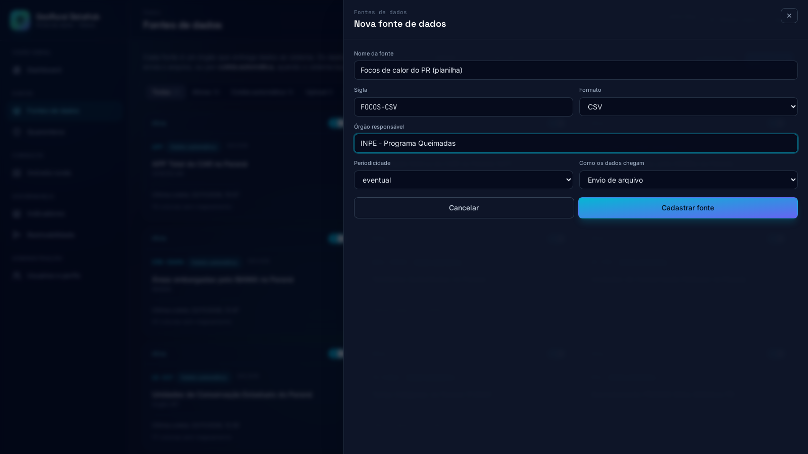

1. Em **Fontes de dados**, clique em **Nova fonte**.
2. Preencha **Nome da fonte**, **Sigla**, **Formato** (o do arquivo que você vai enviar) e **Órgão
   responsável**. Em **Periodicidade**, escolha de quanto em quanto tempo chega arquivo novo (só
   informativo).
3. Em **Como os dados chegam**, deixe **Envio de arquivo**.
4. Clique em **Cadastrar fonte**. A fonte aparece na lista com a etiqueta **Upload** e a página dela
   abre na aba **Recebimento**.
5. **Envie o primeiro arquivo:** na área **Enviar arquivo**, arraste o arquivo ou clique nela para
   escolher. O nome e o tamanho aparecem na área; **Trocar arquivo** escolhe outro.

   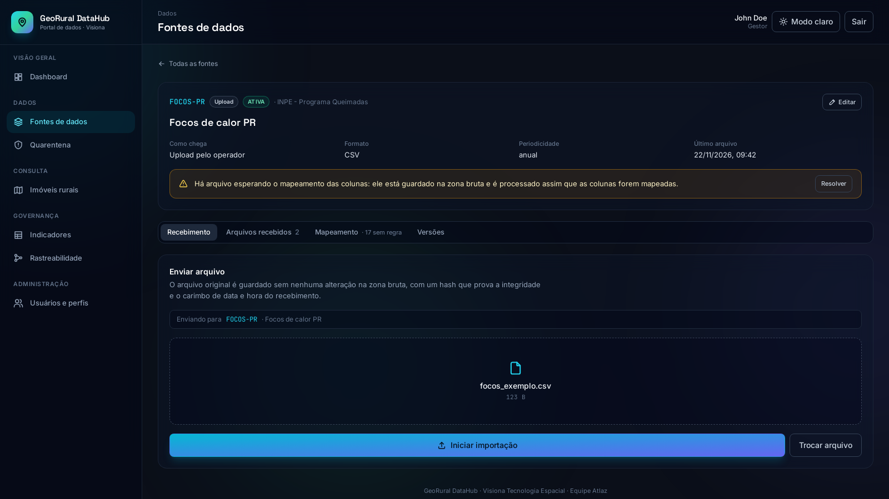

6. Clique em **Iniciar importação**. O arquivo original é guardado sem nenhuma alteração na zona
   bruta, com um hash que prova a integridade e o carimbo de data e hora do recebimento. Arquivos
   `.zip`, `.geojson`, `.json` e `.csv` vão para o processamento (Airflow) assim que o envio termina.
   Se o Airflow estiver fora do ar, a tela avisa e o arquivo fica como **Recebido**, para clicar em
   **Processar** depois.
7. Como a fonte ainda não tem mapeamento, o primeiro arquivo fica **Aguardando mapeamento** e a
   página mostra a faixa "Há arquivo esperando o mapeamento das colunas". Clique em **Resolver** (ou
   em **Mapear colunas** no arquivo), mapeie as colunas (veja
   [Mapeamento de colunas](#mapeamento-de-colunas)) e o arquivo é processado.

   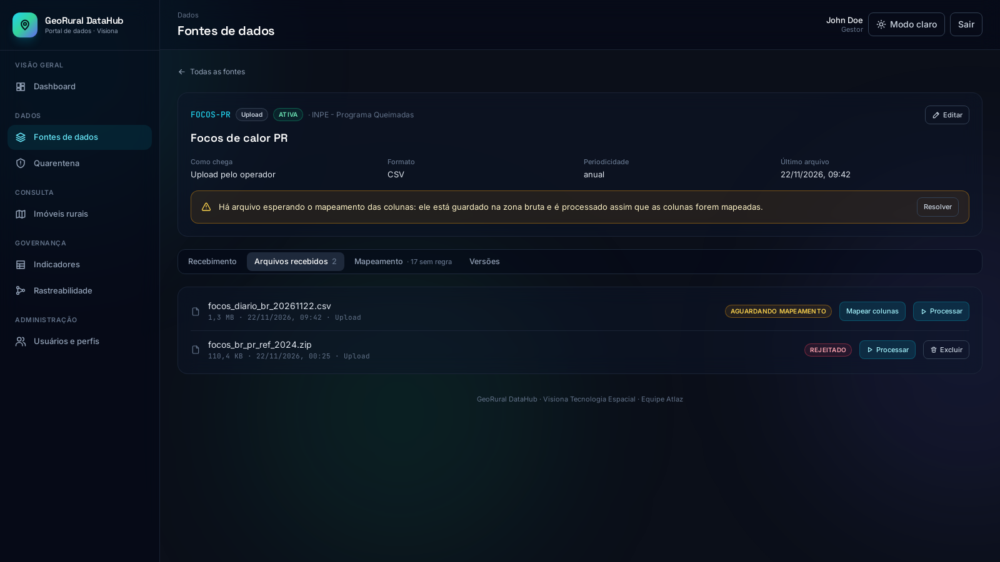

8. Nas próximas vezes, basta abrir a fonte e repetir os passos 5 e 6 com o arquivo novo.

#### Cadastrar uma fonte por link (coleta automática)

Use quando o órgão publica o dado num serviço ArcGIS, WFS/GeoServer ou num arquivo para download.
Depois da primeira coleta, a fonte se atualiza **sozinha**, conforme a periodicidade.

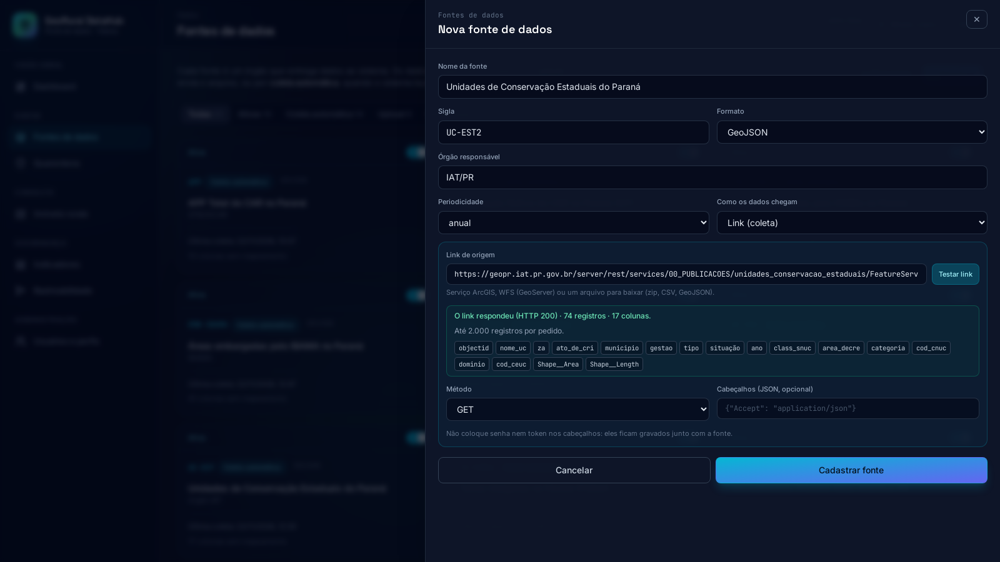

1. Em **Fontes de dados**, clique em **Nova fonte**.
2. Preencha **Nome da fonte**, **Sigla**, **Formato** (o que o link devolve; ArcGIS e WFS em JSON são
   **GeoJSON**) e **Órgão responsável**.
3. Em **Periodicidade**, escolha de quanto em quanto tempo o sistema deve coletar de novo:
   **diária**, **semanal**, **mensal** ou **anual**. Escolha **eventual** para coletar só quando
   alguém clicar em **Executar agora**.
4. Em **Como os dados chegam**, escolha **Link (coleta)**. Aparece o bloco do link.
5. Cole o **Link de origem** e clique em **Testar link**. A tela diz se o endereço respondeu
   (ex.: "O link respondeu (HTTP 200) · 74 registros · 17 colunas."), quantos registros vêm por
   pedido e mostra as colunas que chegaram. O teste **não grava nada** nem dispara coleta.
6. Deixe o **Método** em **GET** e os **Cabeçalhos** vazios, a não ser que o serviço peça.
7. Clique em **Cadastrar fonte**. A fonte aparece com a etiqueta **Coleta automática**.
8. Na aba **Mapeamento**, mapeie as colunas **antes** da primeira coleta (veja
   [Mapeamento de colunas](#mapeamento-de-colunas)). As colunas aparecem depois do teste do link.
9. Na aba **Recebimento**, clique em **Executar agora** para fazer a **primeira coleta**. A partir
   dela, a coleta automática segue sozinha.

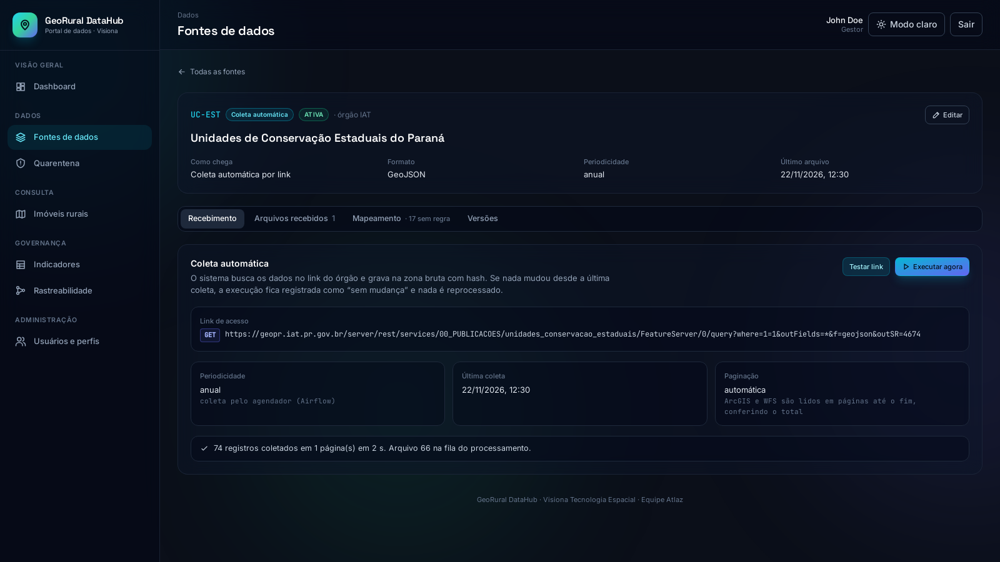

**Como a coleta automática funciona:**

- De hora em hora, o sistema confere quais fontes por link **venceram**: a conta parte da **última
  coleta** e soma a periodicidade (uma fonte **mensal** coletada em 10/11 vence em 10/12). Só a
  fonte vencida é coletada, pelo mesmo caminho do botão **Executar agora**.
- A **primeira coleta é sempre manual** (botão **Executar agora**): fonte que nunca coletou não
  entra na coleta automática.
- **Eventual** não tem coleta automática. Fonte **desativada**, sem link ou com uma coleta em
  andamento também fica de fora.
- Se a coleta **falhar**, a fonte só tenta de novo no **próximo período** (não fica tentando a cada
  hora). Corrija o problema e use **Executar agora** se precisar do dado antes.
- Se o conteúdo for igual ao da última coleta, a execução fica como **sem mudança** e nada é
  reprocessado.
- As fontes com coleta automática, a periodicidade e a última coleta aparecem no
  [Dashboard](#dashboard-operacional).

> **Horário exato (cron):** quem precisa de um horário fixo (ex.: todo dia às 6h) pode gravar um
> `cron` na fonte, que passa na frente da periodicidade. O cron é configurado pela equipe técnica
> (API ou seed), em horário de Brasília; ainda não há campo na tela para ele.

**Ordem certa para uma fonte nova:**

1. Cadastre a fonte e **teste o link** (ou envie o primeiro arquivo).
2. Vá na aba **Mapeamento** e mapeie as colunas **antes** de coletar ou processar. As colunas
   aparecem depois do teste do link ou do primeiro arquivo.
3. Só então clique em **Executar agora** (link) ou processe o arquivo.

Se a carga rodar antes do mapeamento, o arquivo fica **Aguardando mapeamento** ou os registros vão
todos para a quarentena; depois de mapear, use **Reprocessar** (veja abaixo).

**Editar uma fonte:** o botão **Editar**, no topo da página da fonte, abre o mesmo formulário (a
sigla não muda). Se uma fonte por link passar para **Envio de arquivo**, o link é apagado e ela sai
da coleta automática; os arquivos já recebidos continuam como estão.

#### Abas da página da fonte

**Aba Recebimento:**

- **Fonte por link:** mostra o link, a periodicidade, a última coleta e a paginação. **Executar
  agora** baixa os dados na hora; **Testar link** confere o endereço de novo. Serviços ArcGIS e WFS
  são lidos **em páginas** até o fim, conferindo o total; se faltar ou repetir algum registro, a
  coleta falha ("vieram X de Y") em vez de gravar dado pela metade. **Coletar de novo não corrige um
  mapeamento** (o conteúdo não mudou): use **Reprocessar**.
- **Fonte por envio de arquivo:** a área **Enviar arquivo** (veja o passo a passo acima).
- **Fonte desativada:** só o aviso "Fonte desativada" e o botão **Ativar fonte**.

**Aba Arquivos recebidos:**

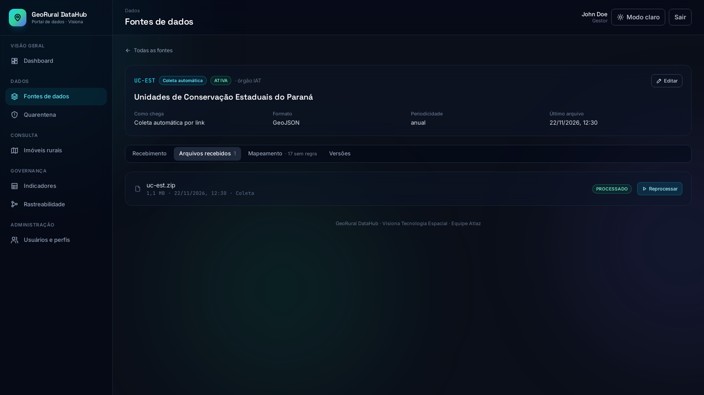

1. Cada arquivo mostra nome, tamanho, data, se veio por **Coleta** ou **Upload**, e o status:
   **Recebido**, **Processando**, **Processado**, **Rejeitado** ou **Aguardando mapeamento**.
   Enquanto houver arquivo processando, a lista se atualiza sozinha e mostra a barra de progresso.
2. **Processar**: aparece nos arquivos Recebidos, Rejeitados ou Aguardando mapeamento.
3. **Interromper**: aparece no arquivo que está processando. Para continuar depois, clique em
   **Processar**: ele recomeça do início, com o mesmo mapeamento.
4. **Reprocessar**: aparece só no arquivo **Processado mais recente** da fonte (é ele que está
   valendo). Use depois de mudar o mapeamento: o arquivo é lido de novo, sem precisar baixar ou
   subir outra vez, e os dados atuais da fonte são trocados pelos da nova leitura.
5. **Excluir**: só em arquivos Rejeitados. Apaga o arquivo do catálogo e da zona bruta e não pode
   ser desfeito.
6. Reprocessar, interromper e excluir pedem confirmação antes.
7. Os registros reprovados ficam na [Quarentena](#quarentena). Para ver **quantos** foram válidos e
   inválidos, confira as execuções da fonte (ou as **Execuções recentes** do Dashboard): se
   **todos** foram reprovados, quase sempre é um campo mapeado do jeito errado (abra um registro na
   Quarentena para ver o motivo).

**Aba Versões:** cada processamento gera uma versão dos dados da fonte (v1, v2…), com a data, a
execução, o arquivo, o hash e quantos registros. A mais nova fica marcada como **Atual**; as antigas
ficam **Imutáveis** e nunca são alteradas. É isso que permite explicar por que um indicador mudou
(veja [Rastreabilidade](#rastreabilidade)).

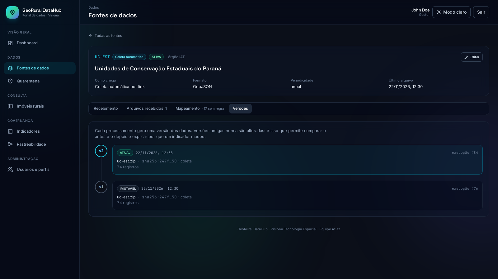

### Mapeamento de colunas

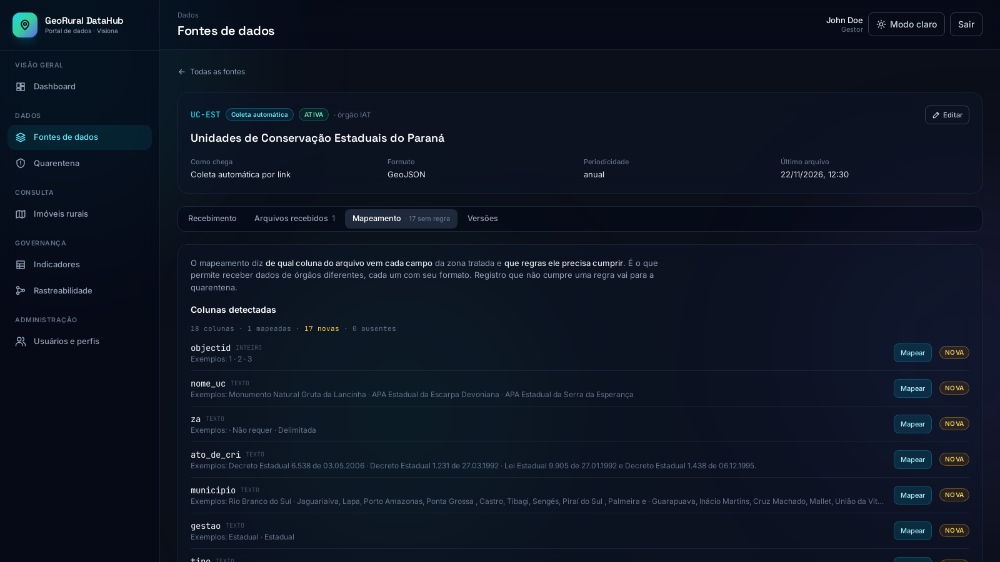

Fica na aba **Mapeamento** da página da fonte. O mapeamento diz, coluna por coluna, para onde vai
cada dado e que regras ele precisa cumprir. **Só o que está mapeado é gravado**; as colunas sem
mapeamento não se perdem: ficam guardadas como atributos de cada registro na zona bruta e na
quarentena.

1. Em **Colunas detectadas**, veja as colunas que chegaram, com tipo percebido e exemplos. Cada uma
   aparece como **Mapeada**, **Nova** ou **Ausente**.
2. Clique em **Mapear** numa coluna. O formulário abre logo abaixo da lista; preencha os campos
   (tabela abaixo).
3. Clique em **Salvar mapeamento**. A coluna passa para **Colunas mapeadas**, onde dá para
   **Editar** ou **Remover**.
4. Se houver arquivo **aguardando mapeamento**, aparece uma faixa amarela com o botão para
   reprocessar todos. Se o arquivo já tinha sido processado, use **Reprocessar** na aba
   **Arquivos recebidos**.

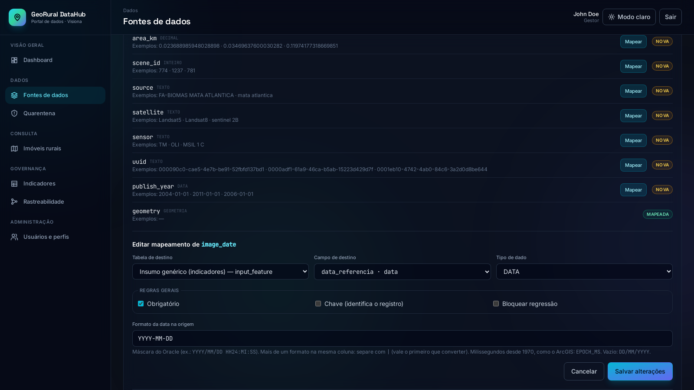

**Campos do mapeamento:**

| Campo | Como preencher |
|---|---|
| **Tabela de destino** | Onde o dado vai morar. As tabelas próprias (`imovel_rural`, `car_reserva_legal`, `foco_calor`, `municipio`) são das fontes do CAR, dos focos e dos municípios. **Qualquer outra fonte** (desmatamento, áreas protegidas, embargos…) vai para **`input_feature`** (Insumo genérico), o destino que os indicadores cadastrados pela tela usam. |
| **Campo de destino** | O campo da tabela. Na `input_feature`: **`geometria`** (o desenho), **`categoria`** (um texto para filtrar no indicador, ex.: a classe "DESMATAMENTO"), **`data_referencia`** (a data da observação, usada no filtro "A partir de") e **`valor`** (um número declarado pela fonte). Um campo já usado por outra coluna aparece como "já mapeado". |
| **Tipo de dado** | O tipo do **valor que vem da origem**: TEXTO, INTEIRO, DECIMAL, DATA, BOOLEANO ou GEOMETRIA. O valor que não converte vai para a quarentena ("Valor não converte para DATA", por exemplo). |
| **Obrigatório** | Marque quando o registro não serve sem esse valor; vazio vai para a quarentena. Se a tela avisar "A tabela não aceita este campo vazio", **marque**: sem isso, um valor vazio derruba a carga inteira em vez de ir para a quarentena. **A geometria é sempre obrigatória.** |
| **Chave (identifica o registro)** | A coluna que diz "é o mesmo registro" de uma carga para a outra (ex.: `cod_imovel` no CAR, o código IBGE nos municípios). Com chave, a carga atualiza o que mudou; sem chave, cada carga substitui a anterior inteira. Uma chave é sempre obrigatória. Na dúvida, **não marque**. |
| **Bloquear regressão** | Reprova o registro que chega vazio num campo que hoje está preenchido (evita apagar um dado bom com uma carga ruim). |

**Só para GEOMETRIA:**

| Campo | Como preencher |
|---|---|
| **Tipo esperado** | **Polígono** para áreas (imóvel, reserva legal, município, desmatamento, unidade de conservação…), **Ponto** para qualquer ponto (focos de calor e outros) e **Linha** para rios e estradas. Polígono aceita multipolígono, e assim por diante. Uma geometria de outro tipo é reprovada. |
| **Política para geometria inválida** | **Corrigir e registrar** (recomendado): o sistema conserta o desenho (contorno que se cruza, ponto repetido…), grava e anota a correção. **Quarentena**: reprova e isola o registro para alguém corrigir à mão. |
| **Conferir se está no Paraná** | Marque nas fontes do PR: um desenho **totalmente fora** do estado é reprovado; **parcialmente fora** passa, sem recorte. Depende da malha de municípios carregada (`MUN-IAT`); sem ela, a carga avisa e não valida. Não marque na própria fonte de municípios. |

**Só para DATA:**

| Campo | Como preencher |
|---|---|
| **Formato da data na origem** | A máscara do jeito que a data vem. **Vazio vale `DD/MM/YYYY`.** Exemplos: `2006-09-12` → `YYYY-MM-DD`; `2015/03/11 17:19:00` → `YYYY/MM/DD HH24:MI:SS`. Texto fixo no meio da data vai entre aspas (ex.: `2024-05-01T10:00:00` → `YYYY-MM-DD"T"HH24:MI:SS`). Se a coluna mistura formatos, separe com `\|` (vale o primeiro que converter). Milissegundos desde 1970 (comum no ArcGIS) → `EPOCH_MS`. **Formato errado reprova todos os registros** ("Valor não converte para DATA"): confira um exemplo da coluna antes. |

**Só para DECIMAL:** marque **"A origem usa vírgula como separador decimal"** quando o número vem
como `25,9`.

**Só para TEXTO:**

| Campo | Como preencher |
|---|---|
| **Domínio de valores** | Lista dos valores aceitos (ex.: situação do CAR). Valor fora da lista vai para a quarentena. |
| **Conferir existência em** | Confere se o valor existe em outra tabela (município ou imóvel). Só **valida**: não liga o registro a ela. |
| **Validar CPF/CNPJ** | Reprova documentos com dígito verificador errado. |

**Exemplos que funcionaram:**

- **Desmatamento PRODES (link WFS do INPE)** para os indicadores de desmatamento: `geometry` →
  `input_feature.geometria` (Polígono, obrigatório, Corrigir e registrar, conferir no PR);
  `main_class` → `input_feature.categoria` (TEXTO, obrigatório); `image_date` →
  `input_feature.data_referencia` (DATA, obrigatório, formato `YYYY-MM-DD`).
- **Camadas só de desenho** (terras indígenas, unidades de conservação, quilombolas, embargos):
  basta a `geometry` → `input_feature.geometria`, com as mesmas opções acima.
- **CSV de pontos:** a coluna da geometria (WKT ou latitude/longitude) como GEOMETRIA **Ponto**
  obrigatória; uma área com vírgula como DECIMAL com a caixinha da vírgula → `valor`.

### Quarentena

Registros que não cumpriram alguma regra do mapeamento. O dado original na zona bruta nunca é
alterado: a correção é guardada à parte e validada de novo antes de ir para a zona tratada.

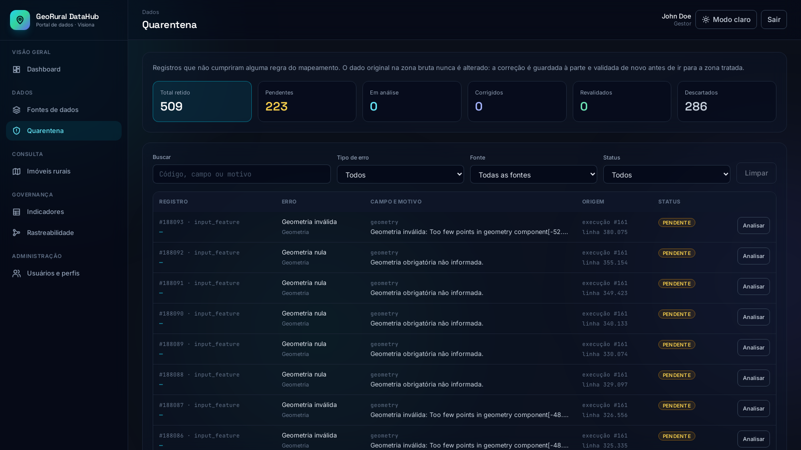

**Visão geral:**

- **Métricas:** Total retido, Pendentes, Em análise, Corrigidos, Revalidados e Descartados. Os
  Substituídos ficam guardados, mas não contam no total nem aparecem na lista geral. Registros sem
  geometria e com área declarada 0 já chegam como Descartados, com a justificativa. Clicar
  num cartão filtra a lista por aquele status; clicar de novo desfaz o filtro.
- **Filtros:** Buscar (código, campo ou motivo), Tipo de erro, Fonte (só as fontes ativas) e
  Status. **Limpar** remove todos.
- **Tabela:** registro, erro, campo e motivo, origem (execução e linha do arquivo) e status, com 20
  registros por página.
- No fim da tela, o card **Os tipos de erro que a validação encontra** explica cada código de erro.

**Passo a passo para tratar um registro:**

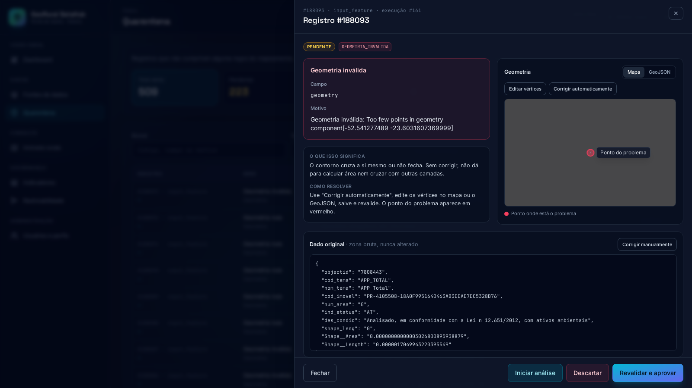

1. Clique em **Analisar** na linha do registro. Abre uma gaveta com o erro (campo, valor recebido e
   motivo), uma explicação de **O que isso significa** e **Como resolver**, a geometria (aba
   **Mapa** ou **GeoJSON**), o dado original e o histórico do registro.
2. Clique em **Iniciar análise** (o status passa a **Em análise**).
3. Corrija, conforme o tipo de problema:
   - **Campos:** clique em **Corrigir manualmente**, edite a cópia de trabalho (em JSON, no mesmo
     formato do dado original) e clique em **Salvar correção**.
   - **Geometria:** no mapa da gaveta, o ponto do problema aparece em vermelho e a geometria como
     chegou, em ciano. Você pode:
     - **Corrigir automaticamente** — mostra uma prévia da correção em verde, que você pode
       ajustar;
     - **Editar vértices** — arraste os vértices; clique no meio de uma aresta para criar um e use
       o botão direito para apagar;
     - **Desenhar nova** — clique no mapa para marcar os vértices e no primeiro para fechar o
       polígono (use quando o registro chegou sem geometria);
     - **Desfazer** — volta à última versão salva.

     Depois, clique em **Salvar geometria**. O sistema recusa uma geometria que continue inválida e
     diz o motivo (por exemplo, "o contorno se cruza").
4. Clique em **Revalidar e aprovar**. O registro passa de novo por todas as regras:
   - se passar, é gravado na zona tratada e fica **Revalidado**;
   - se não passar, a gaveta lista os erros que continuam, para você corrigir de novo.
5. Se o registro não tiver como ser aproveitado, escreva a **Justificativa** e clique em
   **Descartar**. A justificativa é obrigatória.

Registros **Revalidados**, **Descartados** ou **Substituídos** ficam encerrados: só podem ser
consultados, e o histórico fica guardado para auditoria. Um registro fica **Substituído**
automaticamente quando uma carga mais nova traz o mesmo registro.

### Imóveis rurais

Tela usada pelo Analista para consultar e visualizar os imóveis já processados. O **mapa ocupa a
tela inteira**; por cima dele ficam o painel flutuante **Filtro e imóveis** (à esquerda), a legenda
(no alto, à direita) e o botão **Voltar ao painel**, que leva ao Dashboard.

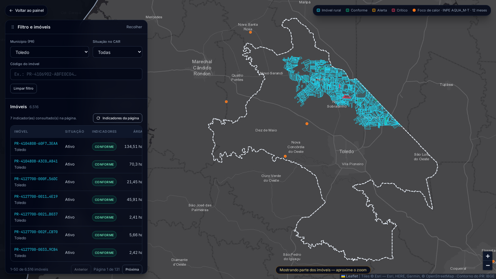

- **O painel** pode ser arrastado pela barra "Filtro e imóveis" para outro canto do mapa;
  **Recolher** esconde o conteúdo e deixa só a barra.
- **A legenda** mostra as cores do mapa: **Imóvel rural**, os status dos indicadores (**Conforme**,
  **Alerta**, **Crítico**) e o **Foco de calor** do INPE (satélite de referência, últimos 12 meses).

**Passo a passo:**

1. **Filtrar** (opcional): escolha um **Município (PR)**, uma **Situação no CAR** (Ativo,
   Pendente, Cancelado, Suspenso) e/ou digite parte do **Código do imóvel**. Os filtros podem ser
   combinados; **Limpar filtro** remove todos. Ao escolher um município, o mapa se ajusta a ele e
   desenha o contorno tracejado.
2. **Consultar na tabela:** os imóveis aparecem com código, município, situação, **indicadores** e
   área (ha), 50 por página, com o total ao lado do título **Imóveis**. Use **Anterior** e
   **Próxima** para navegar.
3. **Ver o status dos indicadores da página:** clique em **Indicadores da página**. A coluna
   **Indicadores** mostra, para cada imóvel, o **pior status** entre os indicadores cadastrados e
   ativos (por exemplo, se um está Conforme e outro Crítico, aparece **Crítico**), e o mapa pinta os
   imóveis com a cor desse status. A frase "7 indicador(es) consultado(s) na página" confirma
   quantos foram lidos. O IRL e o IFC não entram nessa coluna: eles aparecem no card do imóvel.
4. **Consultar no mapa:** o mapa abre mostrando o Paraná inteiro e não sai dos limites do estado.
   Os imóveis só aparecem a partir de um certo zoom; antes disso, a mensagem "Aproxime o zoom para
   ver os imóveis" pede para aproximar. Se a área visível tiver imóveis demais, aparece "Mostrando
   parte dos imóveis — aproxime o zoom". Os **focos de calor** do INPE aparecem como pontos
   laranja; passe o mouse para ver o satélite e a data.
5. **Selecionar um imóvel:** clique numa linha da tabela ou num imóvel no mapa. A seleção é
   sincronizada: pela tabela, o mapa vai até o imóvel; pelo mapa, a linha é destacada. Um balão
   mostra código, município, área e situação. Clique de novo para desmarcar.
6. **Ver os indicadores** do imóvel selecionado no card **Indicadores do imóvel**, no painel, com o
   código do imóvel logo abaixo do título:
   - **IRL · Reserva Legal** — percentual de Reserva Legal, numa barra de 0% a 40% com a marca do
     mínimo de 20%, e quantos hectares faltam ou sobram. Situação: **Conforme** ou **Crítico**;
   - **IFC · Focos de calor** — focos a cada 1.000 ha nos últimos 12 meses e o total de focos
     detectados no imóvel. Situação: **Sem focos**, **Alerta** ou **Crítico**;
   - cada indicador mostra, no rodapé, a regra e a versão usadas, as versões dos dados e quando foi
     calculado; **De onde veio este número?** abre a [Rastreabilidade](#rastreabilidade).

   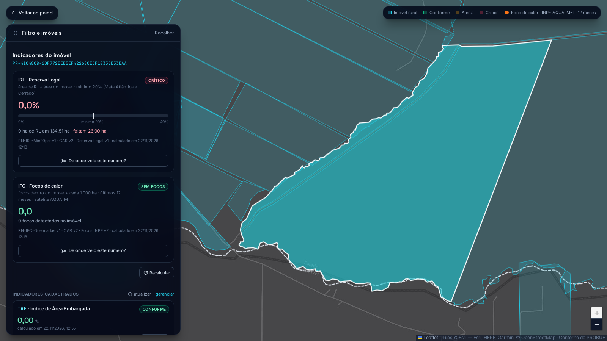

7. **Indicadores cadastrados:** logo abaixo, o bloco **Indicadores cadastrados** lista os
   indicadores montados na tela [Indicadores](#indicadores) (ex.: IAE, ICV, IDES08, ISAP), cada um
   com o valor, o status e quando foi calculado. Nos indicadores com **Mínimo exigido**, aparece o
   déficit ou o excedente em hectares (ex.: "Déficit de 1,74 ha (mínimo 20% = 26,88 ha; tem 25,14
   ha)"). **atualizar** relê os resultados e **gerenciar** abre a tela Indicadores.
8. **Análise gráfica:** no fim do painel, o gráfico **Distribuição por status (página atual)**
   mostra quantos imóveis da página estão Conforme, Alerta, Crítico e Em validação (depois de
   clicar em **Indicadores da página** ou de selecionar um imóvel).

   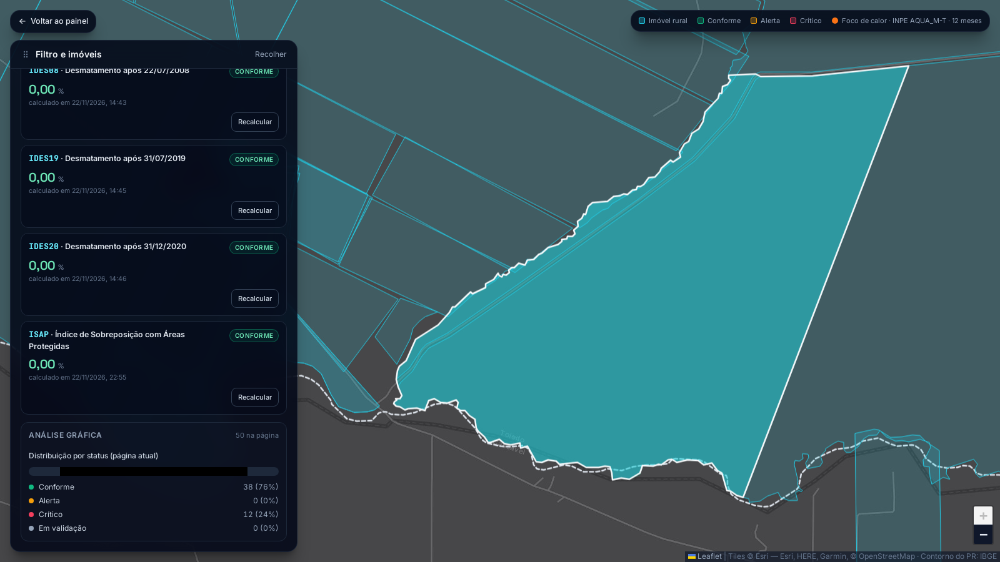

**Calcular e recalcular** (Operador de dados e Gestor): se os indicadores ainda não foram
calculados, clique em **Calcular indicadores**. Depois de carregar dados novos, use **Recalcular**
(no card do IRL/IFC ou em cada indicador cadastrado). O cálculo vale para **todos** os imóveis e
pode levar alguns minutos.

> **Analista com cidades liberadas:** quem tem o perfil Analista vê só os imóveis das cidades que o
> Gestor liberou para ele (veja [Cadastrar um novo usuário](#cadastrar-um-novo-usuário)). O filtro
> **Município (PR)** lista só essas cidades e o painel avisa "Você consulta só as cidades liberadas pelo gestor". Analista com **Todas as cidades** vê o Paraná inteiro.

### Indicadores

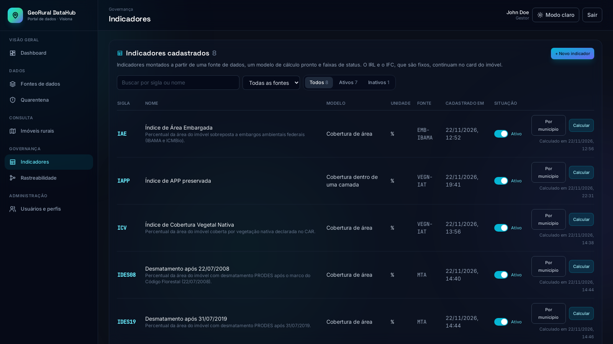

Tela em **Governança > Indicadores**. Aqui ficam os indicadores montados a partir de uma fonte de
dados, de um modelo de cálculo pronto e de faixas de status. O **IRL** e o **IFC** são fixos: não
aparecem nesta lista e são vistos no card do imóvel (veja [Imóveis rurais](#imóveis-rurais)).

**A lista:** sigla, nome (com a descrição), modelo, unidade, fonte, data de cadastro, situação e
ações. Dá para filtrar por fonte e ver Todos, Ativos ou Inativos.

- **Chave Ativo/Inativo:** liga e desliga o indicador. Um indicador **inativo** não é mais
  calculado, mas não é apagado: os resultados já calculados continuam valendo e podem ser
  consultados. Para **reativar**, basta clicar na chave de novo: o indicador volta como estava (mesma
  sigla e mesma regra). Depois de reativar, clique em **Calcular** para atualizar os resultados com
  os dados novos.
- **Calcular:** calcula o indicador para todos os imóveis (cerca de 559 mil). Uma barra mostra o
  andamento ("Gravando os resultados 94%"); leva alguns minutos. Só quem opera dados vê o botão, e
  só em indicador ativo. Abaixo do botão fica a data do último cálculo.
- **Por município:** abre o resultado mais recente de cada imóvel agrupado pelo município: quantos
  imóveis, quantos em cada status, a média simples do valor e a **soma** do numerador (hectares
  cobertos, focos…). A busca no topo acha um município. Os números seguem o formato brasileiro:
  `1.973.144,881` são cerca de 1,97 milhão. Imóvel sem município aparece na linha **Sem município**.

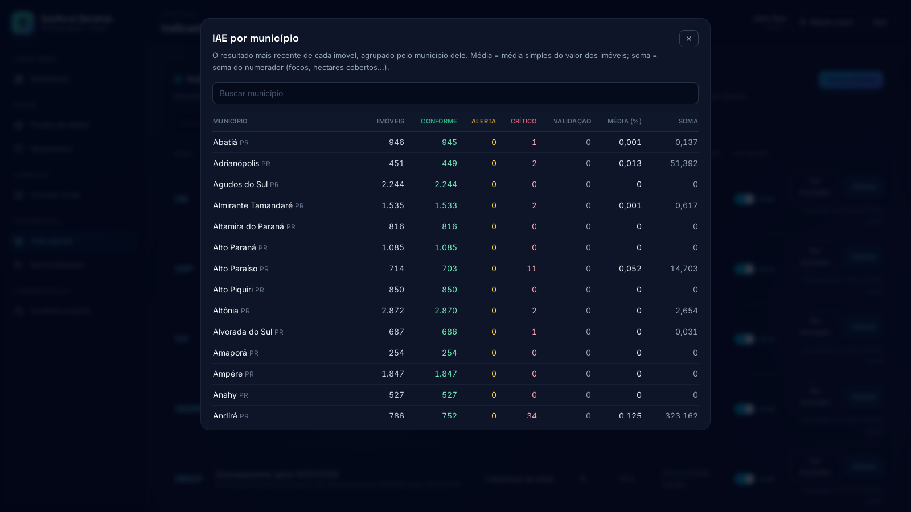

**Cadastrar um indicador:** clique em **+ Novo indicador** e preencha. **Cadastrar não calcula**:
o cálculo é um passo à parte (botão **Calcular**).

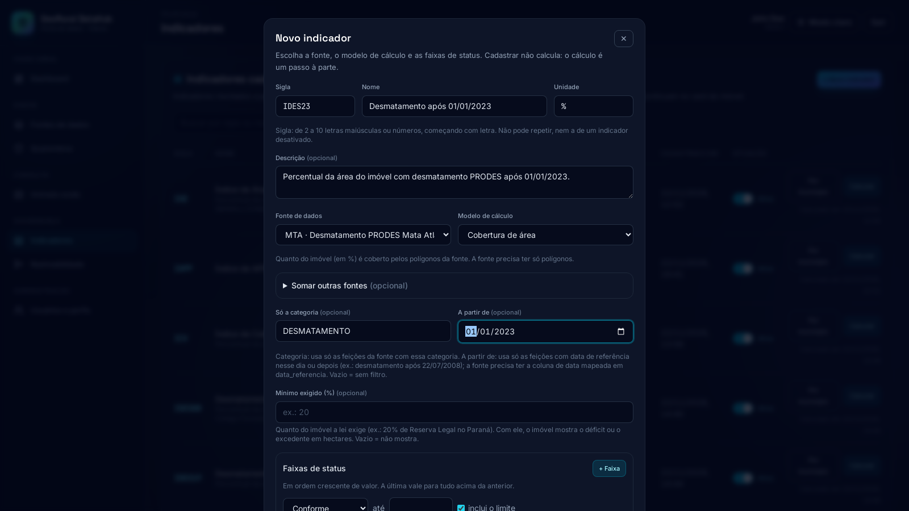

| Campo | Como preencher |
|---|---|
| **Sigla** | De 2 a 10 letras maiúsculas ou números, começando com letra (ex.: `IDES23`). **Não pode repetir**, nem a de um indicador desativado. |
| **Nome** e **Unidade** | Nome por extenso e a unidade do valor: `%` na cobertura de área, `focos/1000` na densidade de pontos. |
| **Descrição** (opcional) | Uma frase dizendo o que o número mede. Ajuda quem lê o resultado depois. |
| **Fonte de dados** | A fonte principal (só aparecem fontes ativas). Ela precisa **já ter dados processados** no destino genérico (`input_feature`), com a geometria mapeada; senão aparece "A fonte N ainda não tem dados processados no insumo genérico". |
| **Modelo de cálculo** | Veja a tabela de modelos abaixo. O tipo de geometria da fonte tem que combinar com o modelo. |
| **Somar outras fontes** (opcional) | Para um indicador feito de várias camadas (ex.: áreas protegidas = UC + terra indígena + quilombola). Na cobertura, a área coberta por mais de uma fonte conta **uma vez só**. Todas precisam ter o mesmo tipo de geometria da principal. |
| **Pontos a cada quantos hectares** | Só na densidade de pontos: a base da conta (ex.: `1000` → focos a cada 1.000 ha). |
| **Só a categoria** (opcional) | Usa só as feições cuja `categoria` é igual a este texto, **exatamente como vem na fonte** (maiúsculas contam; ex.: `DESMATAMENTO`). Vazio = todas as feições, sem filtro. |
| **A partir de** (opcional) | Usa só as feições com `data_referencia` nesse dia ou depois (ex.: desmatamento após 22/07/2008). A fonte precisa ter a data mapeada em `data_referencia`. Vazio = sem filtro. |
| **Mínimo exigido (%)** (opcional) | Só na cobertura de área, quando **mais é melhor**: quanto do imóvel a lei exige (ex.: 20% de Reserva Legal no Paraná). Com ele, o imóvel mostra o déficit ou o excedente em hectares. Em indicador onde **qualquer valor é ruim** (desmatamento, embargo), deixe vazio. |
| **Faixas de status** | Em **ordem crescente** de valor. Cada faixa tem um status (Conforme, Alerta, Crítico ou Validação), um limite e a opção **inclui o limite**. A **última vale para tudo acima** da anterior e não tem limite. **+ Faixa** acrescenta uma. |

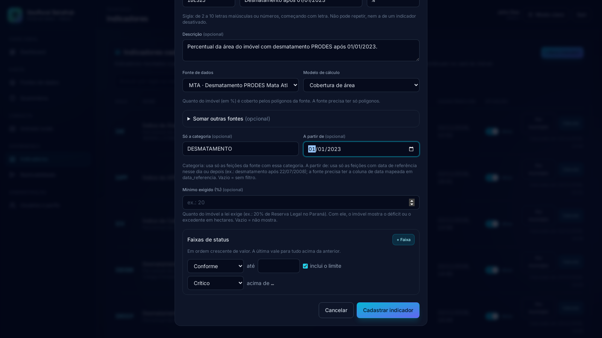

**Modelos de cálculo:**

| Modelo | O que calcula | A fonte precisa ter | Exemplo |
|---|---|---|---|
| **Densidade de pontos** | Pontos dentro do imóvel, por área | Só pontos | Focos de calor a cada 1.000 ha |
| **Cobertura de área** | Quanto do imóvel (em %) é coberto pelos polígonos da fonte | Só polígonos | Desmatamento, áreas protegidas, embargos, vegetação nativa |
| **Cobertura dentro de uma camada** | Quanto de uma **camada base** dentro do imóvel é coberto pela fonte | Só polígonos, nas duas | APP conservada = APP com vegetação nativa ÷ APP total |

Na **cobertura dentro de uma camada**, a fonte é a cobertura (ex.: vegetação) e a **Camada base**
(o denominador, ex.: APP) é marcada num bloco próprio. Se a base veio em vários pedaços (APP,
APP02, APP03…), marque todos: o cálculo junta. Imóvel sem a camada base não recebe resultado.

**Como pensar as faixas:**

- **Qualquer valor acima de zero é problema** (desmatamento, sobreposição com área protegida,
  embargo): **Conforme** até `0` (inclui o limite) e **Crítico** acima.
- **Mais é melhor** (vegetação nativa, reserva legal): **Crítico** até o mínimo (sem incluir o
  limite) e **Conforme** acima; preencha também o **Mínimo exigido**.
- Para uma zona de atenção, acrescente uma faixa **Alerta** entre as duas.

**Exemplos de indicadores cadastrados:**

| Sigla | Fonte(s) | Modelo | Filtros | Faixas |
|---|---|---|---|---|
| `IDES08` | Desmatamento PRODES (`MTA`) | Cobertura de área | Categoria `DESMATAMENTO`, a partir de 22/07/2008 | Conforme até 0 · Crítico acima |
| `ISAP` | `TI-FUNAI` + `UC-EST`, `UC-FED`, `QUIL-INCRA` | Cobertura de área | — | Conforme até 0 · Crítico acima |
| `IAE` | `EMB-IBAMA` + `EMB-ICMBIO` | Cobertura de área | — | Conforme até 0 · Crítico acima |
| `ICV` | `VEGN-IAT` | Cobertura de área | Mínimo exigido 20% | Crítico até 20 (sem incluir) · Conforme acima |
| `IAPP` | `VEGN-IAT` sobre a camada base `APP` | Cobertura dentro de uma camada | — | Crítico até o mínimo · Conforme acima |

> **Um indicador não pode ser editado.** Para mudar a regra, desative o indicador e cadastre outro
> com uma sigla nova. Desativar não é definitivo: se mudar de ideia, religue o antigo pela chave.
> Confira tudo (principalmente a categoria e a data) antes de salvar.

### Rastreabilidade

Tela em **Governança > Rastreabilidade**. Mostra o caminho completo de um indicador, do resultado
até o arquivo de origem.

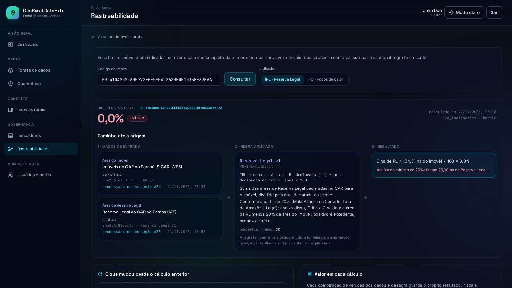

1. Abra pelo botão **De onde veio este número?** no card do imóvel (já chega preenchida), ou digite
   o **Código do imóvel**, escolha o **Indicador** (**IRL · Reserva Legal** ou **IFC · Focos de
   calor**) e clique em **Consultar**.
2. O topo mostra o valor, o status e quando foi calculado.
3. **Caminho até a origem**, em três colunas:
   - **1 · Dados de entrada** — cada dado usado na conta (ex.: área do imóvel, área de Reserva
     Legal), com a fonte, o arquivo, o hash, a versão dos dados e a execução que o processou;
   - **2 · Regra aplicada** — o nome e a versão da regra, a fórmula e os parâmetros (ex.: percentual
     mínimo 20). A regra também é versionada;
   - **3 · Resultado** — a conta feita com os números do imóvel (ex.: "0 ha de RL ÷ 134,51 ha do
     imóvel × 100 = 0,0%") e o que ela significa.
4. **O que mudou desde o cálculo anterior** diz se mudou o dado, a regra ou os dois.
5. **Valor em cada cálculo** lista todos os cálculos guardados, com as versões dos dados e da regra
   de cada um. Nada é sobrescrito.
6. **Voltar aos imóveis rurais** volta para o mapa.

### Usuários e perfis

Tela usada pelo Gestor, em **Administração > Usuários e perfis**, para cadastrar pessoas e definir o
que cada uma pode usar no sistema. Os demais perfis não veem este item no menu.

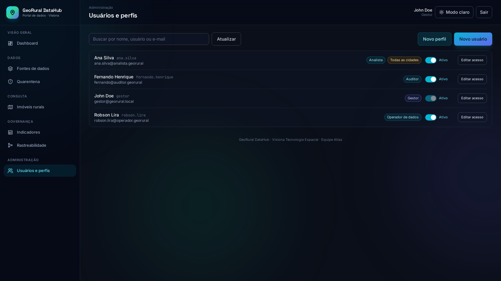

**A lista:**

1. Cada linha mostra o nome, o usuário (login), o e-mail e os perfis da pessoa, em etiquetas. No
   Analista aparece também a região liberada (**Todas as cidades** ou quantas cidades). Quem não tem
   nenhum perfil aparece como **Sem perfil**.
2. **Buscar:** digite no campo "Buscar por nome, usuário ou e-mail". A lista se atualiza sozinha
   depois que você para de digitar. **Atualizar** recarrega a lista.
3. A lista mostra 20 pessoas por página; use **Anterior** e **Próxima** para navegar.
4. **Chave Ativo/Inativo:** liga ou desliga o acesso da pessoa. **Desativada**, ela não consegue
   entrar; os perfis e as cidades ficam guardados e voltam quando a chave é religada. Você não pode
   desativar o seu próprio usuário.

#### Cadastrar um novo usuário

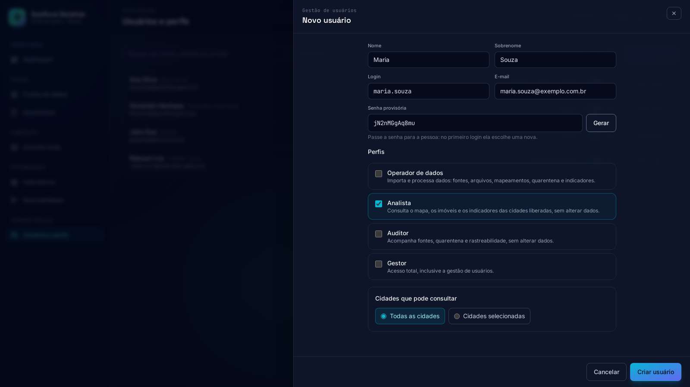

1. Clique em **Novo usuário**. Abre a gaveta **Novo usuário**.
2. Preencha os **Dados de acesso**:

   | Campo | Como preencher |
   |---|---|
   | **Nome** e **Sobrenome** | Como a pessoa vai aparecer no topo da tela e na lista. |
   | **Login** | O nome de usuário para entrar, de 3 a 50 letras, números, ponto, hífen ou sublinhado (ex.: `maria.souza`). |
   | **E-mail** | Um e-mail válido da pessoa. Também serve para entrar no lugar do login. |
   | **Senha provisória** | Pelo menos 8 caracteres. Clique em **Gerar** para o sistema sugerir uma senha forte. **Passe a senha para a pessoa**: no primeiro login, o sistema pede que ela escolha uma nova. |

3. Em **Perfis**, marque um ou mais (o **Analista** já vem marcado). Os perfis combinados criados
   pelo Gestor também aparecem aqui.
4. Se a pessoa tiver o perfil **Analista** (direto ou dentro de um perfil combinado), aparece o
   bloco **Cidades que pode consultar**:
   - **Todas as cidades** — vê o Paraná inteiro;
   - **Cidades selecionadas** — digite em **Buscar município** (sem acento também acha:
     "maringa" encontra Maringá) e marque as cidades. As escolhidas aparecem como etiquetas no topo;
     clique no **✕** de uma etiqueta para tirá-la. O contador mostra quantas foram escolhidas
     ("3 de 399 cidades escolhidas").

   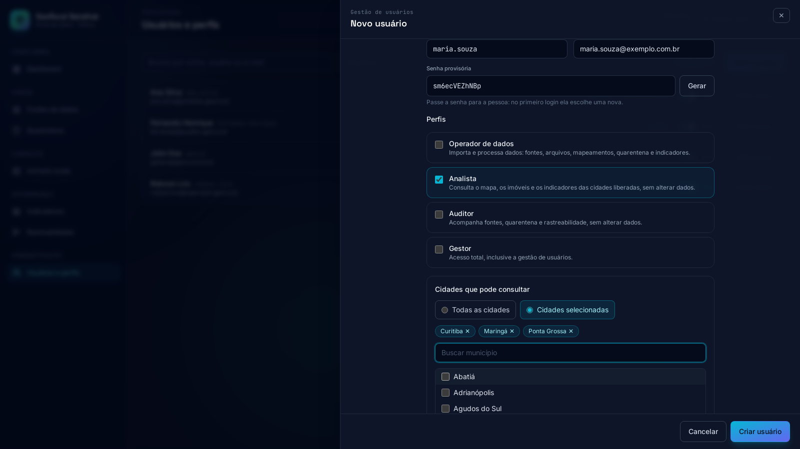

5. Clique em **Criar usuário**. O botão só libera com tudo preenchido; enquanto faltar algo, o rodapé
   diz o quê (ex.: "Informe um e-mail válido.", "Escolha pelo menos uma cidade, ou libere todas.").
6. A gaveta fecha, a pessoa aparece no topo da lista e o aviso lembra: "Usuário … criado. Passe a
   senha provisória para a pessoa."

#### Editar o acesso de alguém

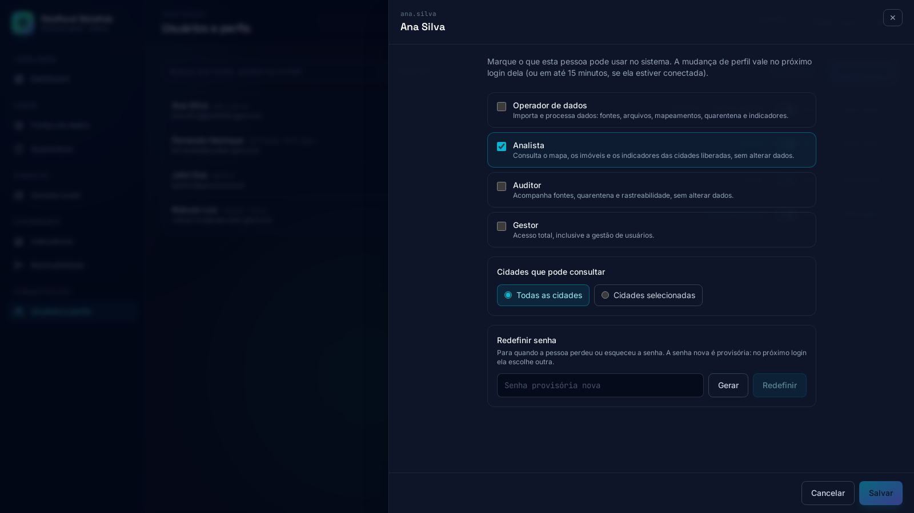

1. Clique em **Editar acesso** na linha da pessoa. Abre uma gaveta à direita com os perfis, cada um
   com uma explicação do que permite:
   - **Operador de dados:** importa e processa dados (fontes, arquivos, mapeamentos, quarentena e
     indicadores);
   - **Analista:** consulta o mapa, os imóveis e os indicadores das cidades liberadas, sem alterar
     dados;
   - **Auditor:** acompanha fontes, quarentena e rastreabilidade, sem alterar dados;
   - **Gestor:** acesso total, inclusive a gestão de usuários;
   - e os perfis combinados, se houver (com o link **Editar descrição**).
2. Marque ou desmarque os perfis. No Analista, ajuste também as **Cidades que pode consultar**.
3. O botão **Salvar** só fica ativo depois de uma mudança. **Cancelar**, o **✕** e a tecla **Esc**
   fecham a gaveta sem salvar.
4. Clique em **Salvar**. A gaveta fecha e a linha da pessoa mostra os novos perfis.

#### Redefinir a senha de alguém

Para quando a pessoa perdeu ou esqueceu a senha. Fica no bloco **Redefinir senha**, no fim da gaveta
**Editar acesso**, e vale na hora (não depende do **Salvar**):

1. Digite uma **Senha provisória nova** ou clique em **Gerar**.
2. Clique em **Redefinir**. A gaveta mostra a senha nova ("Senha redefinida. Passe para a pessoa: …").
3. Passe a senha nova para a pessoa. No próximo login, ela escolhe outra.

#### Criar um perfil combinado

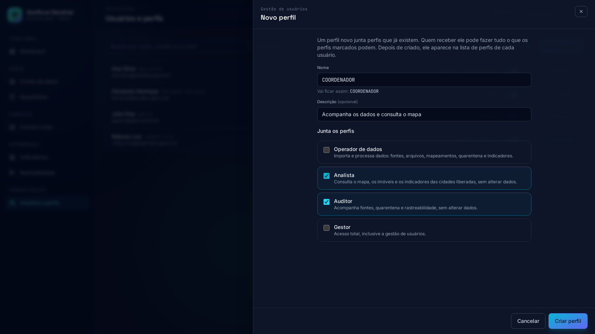

Um perfil combinado junta perfis que já existem. Quem receber ele pode fazer tudo o que os perfis
marcados podem; o que cada perfil do sistema faz não muda.

1. Clique em **Novo perfil**.
2. Dê um **Nome**, de 3 a 30 letras, números ou sublinhado, começando com letra. Ele é gravado em
   maiúsculas e com sublinhado no lugar dos espaços ("Vai ficar assim: COORDENADOR"). Não pode ser o
   nome de um perfil do sistema.
3. Escreva uma **Descrição** (opcional), para os outros Gestores entenderem para que serve.
4. Em **Junta os perfis**, marque pelo menos um.
5. Clique em **Criar perfil**. Ele passa a aparecer na lista de perfis do **Novo usuário** e do
   **Editar acesso**.

**Avisos importantes:**

- **A sua própria linha:** o perfil **Gestor** fica travado ("Você não pode remover o seu próprio
  perfil de Gestor"), para você não perder o acesso ao sistema. Para isso, peça a outro Gestor.
- **Sem nenhum perfil:** a pessoa consegue entrar, mas não acessa nenhuma tela.
- **Quando a mudança vale:** no próximo login da pessoa, ou em até 15 minutos se ela estiver
  conectada. Peça a ela para sair e entrar de novo, se precisar da mudança na hora.

## Mensagens comuns e o que fazer

| Mensagem | O que significa | O que fazer |
|---|---|---|
| Volta para a tela de login, ou "Autenticação necessária: envie um token válido." | A sessão terminou | Entre de novo |
| "Você não tem permissão para acessar este recurso." | O seu perfil não libera esta ação | Peça a um Gestor o perfil adequado |
| "Sem acesso a nenhuma área" | A conta entrou, mas não tem perfil | Peça a um Gestor para atribuir um perfil e entre de novo |
| Credenciais inválidas na tela de login | Usuário ou senha incorretos | Confira os dados; se esqueceu a senha, peça a um Gestor para redefini-la |
| "Não foi possível falar com o servidor. Ele está rodando?" | O back-end não respondeu | Confirme que o back-end está no ar (veja [Como instalar e rodar](#como-instalar-e-rodar)) |
| "Você não pode remover o seu próprio perfil de Gestor." | Tentativa de tirar o próprio perfil de Gestor | Peça a outro Gestor, se for mesmo necessário |
| "Você não pode desativar o seu próprio usuário." | Tentativa de desligar a própria conta | Peça a outro Gestor, se for mesmo necessário |
| "Todos os campos devem estar preenchidos." (Novo usuário / Novo perfil) | Falta algum dado; o texto ao lado diz qual | Complete o campo indicado |
| "O serviço de autenticação está indisponível. Tente novamente em instantes." | O Keycloak está fora do ar | Confirme que o container `keycloak` está rodando e tente de novo |
| "Usuário não encontrado" | A pessoa não existe mais no Keycloak | Atualize a lista; confirme com a equipe técnica |
| "A fonte N ainda não tem dados processados no insumo genérico." (Novo indicador) | A fonte ainda não gravou nada em `input_feature`: nunca foi processada, foi processada sem mapeamento ou teve todos os registros reprovados | Confira o mapeamento (a `geometry` precisa estar mapeada), use **Reprocessar** e veja os válidos da execução |
| Execução com **0 válidos** e todos inválidos | Uma regra do mapeamento barra todo mundo | Abra um registro da fonte na **Quarentena** e leia o motivo; corrija o mapeamento e use **Reprocessar** |
| "Valor não converte para DATA." (Quarentena) | O formato da data na origem não bate com a máscara do mapeamento (vazio = `DD/MM/YYYY`) | Edite a coluna no mapeamento e ponha a máscara certa (ex.: `YYYY-MM-DD`); depois **Reprocessar** |
| Execução "sem mudança" depois de corrigir o mapeamento | A coleta compara o conteúdo do link, não o mapeamento | Use **Reprocessar** no arquivo, em vez de **Executar agora** |
| Fonte por link que não coleta sozinha | Ainda não teve a primeira coleta manual, está como **eventual**, desativada, ou a última coleta falhou e ela espera o próximo período | Clique em **Executar agora** uma vez e confira a periodicidade e a chave da fonte |
| "Fonte desativada" na aba Recebimento | A fonte foi desligada pela chave | Clique em **Ativar fonte**, se ela deve voltar a receber dados |
| "Por município" mostra quase tudo em **Sem município** | Os imóveis estão sem o município preenchido | Rode a DAG `calcular_indicadores` (ela preenche o município pelo código do CAR) |

## Limitações conhecidas

- O **Dashboard** aparece no menu de todos os perfis, mas os números só carregam para o **Gestor**;
  os demais veem a tela sem os dados.
- O **cron** (horário exato da coleta automática) só é definido pela equipe técnica, pela API ou
  pelo seed: ainda não há campo na tela.
- A tela **Usuários e perfis** não **exclui** usuários (desative pela chave) nem apaga perfis
  combinados; isso é feito no painel de administração do Keycloak
  (`http://localhost:8081/admin/master/console/`).
- A mudança de perfil vale no **próximo login** (ou em até 15 minutos).
- **Indicador não tem edição** e a sigla não pode ser reaproveitada: para mudar uma regra, é preciso
  desativar e cadastrar outro (o antigo pode ser religado pela chave a qualquer momento).
- O **Testar link** de um serviço ArcGIS com mais de 2.000 registros avisa que "a coleta faz um
  pedido só". O aviso está desatualizado: a coleta lê em páginas e traz tudo.
- A página de uma fonte por link diz "coleta pelo agendador (Airflow)", mas quem confere a
  periodicidade é o back-end; o Airflow só é chamado para a fonte que venceu.
- A restrição por região vale só para o **Analista** (cidades liberadas). Os demais perfis veem
  todos os dados, e ainda não há permissões mais finas dentro de cada perfil.
- A distribuição de permissões por perfil é a configuração atual e ainda será validada com o Product
  Owner; pode mudar.
